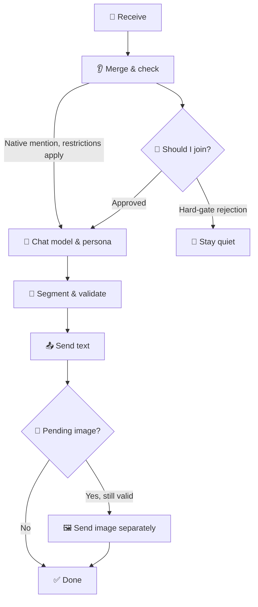

<div align="center">

# 👋 LivingHello

**Help your bot follow the conversation and respond when it makes sense.**


[](https://docs.astrbot.app/)
[](CHANGELOG.md)

[简体中文](README.md) · **English**

**Follow the topic · Decide when to join · Organize replies · Draw when needed**

[Quick start](#quick-start) · [Image generation](#image-generation) · [FAQ](#faq)

</div>

LivingHello is an AstrBot plugin. In group chats, it uses rules and a model to decide whether to join, then passes approved messages to your configured chat model and persona. It can combine consecutive messages, manage reply segments and quotes, and understand or generate images. Optional LivingMemory and LivingEmotion integrations add past memories and the current emotional state.

<a name="features"></a>

## ✨ What can it do?

| You want your bot to… | How LivingHello helps |
| --- | --- |
| Stay quiet when appropriate | Check whether participation makes sense; a hard-gate rejection stops the main reply. |
| Let you finish speaking | Optionally combine consecutive messages from the same user in the same conversation. |
| Understand shared images | Use a configured vision model when needed and pass its observations to the reply model. |
| Make replies easier to read | Manage paragraphs, message segments, first-message quotes and mentions; speech uses native AstrBot settings. |
| Generate or edit images | The main model can call an image tool; the text reply is sent before a separate image message. |
| Use past conversations | Optionally use LivingMemory to retrieve history within the authorized scope. |
| Use the current emotional state | Optionally use LivingEmotion for current emotion, relationships and chat availability. |
| Understand why it stayed quiet | The console shows decisions and traces for receiving, generation, tools and delivery. |

<a name="quick-start"></a>

## 🚀 Quick start

> [!TIP]
>
> Start with the decision model and chat model. Confirm text chat works, then enable memory, emotion or image generation as needed.

### ① Install

In AstrBot’s plugin manager, install the plugin using this repository URL:

```text
https://github.com/AKIhunter/astrbot_plugin_livinghello
```

Requires **AstrBot ≥ 4.29.1**. After installation, open **`guard`** in the plugin details.

### ② Choose a decision model

Open **判定设置 / Decision settings** and choose an affordable model that returns reliable results. Start with the default **hard gate `enforce`** and threshold **`65`**.

> [!NOTE]
>
> The decision model answers “Should I join?” The chat model writes the reply. Leaving the decision model empty uses the conversation’s model, including its pricing.

### ③ Choose the chat model and persona

Open **回复与私聊 / Replies & private chats → AstrBot配置人格 / AstrBot configuration & persona**. Check the configuration you are editing, select a persona and chat model, then click **保存更新 / Save updates**.

AstrBot still assigns configurations to conversations. Make sure your test conversation uses the configuration you just saved.

### ④ Check the result

Open **运行概览 / Overview** to see recent records. For troubleshooting, open a record and follow **receive → decide → generate → tools → deliver**.

**流程与试跑 / Flow & test run** can simulate a text decision. It calls a model but does not generate the main reply or send messages.

> [!IMPORTANT]
>
> Decisions, vision, test runs, speech and image generation may incur API costs, depending on enabled features and providers. Observation mode `shadow` still continues reply generation.

## 🧭 Contents

| Start here | Explore when needed |
| --- | --- |
| [Chat examples](#chat-examples) | [Image generation](#image-generation) |
| [Console & settings](#console) | [Integrations](#integrations) |
| [How it works](#flow) | [FAQ](#faq) |
| [Modes](#modes) | [Commands & interfaces](#commands) |
| [Documentation](#documentation) | [Changelog](#changelog) |

<a name="chat-examples"></a>

## 💬 A few chat examples

These examples illustrate the features. Actual decisions, wording and tool calls depend on your settings, context and models.

### 🤔 “Should I join this conversation?”

| What happens in the group | What the bot considers |
| --- | --- |
| Two people are discussing their own plans. | Is this relevant to me? Would joining help? It may stay quiet. |
| Someone mentions the bot and asks a question. | A native mention has a direct reply path, subject to list restrictions. |
| Someone shares an image and asks what it shows. | Use the configured image-understanding capability before answering. |

### 👂 “Wait, I’m not finished”

```text
🙋 You    "Help me think of a name."
🙋 You    "It’s for a cat."
🙋 You    "An orange one."

🤖 Combined meaning
   "Suggest a name for an orange cat."
```

With fragment merging enabled, another message from the same user resets the quiet period. Defaults are **3 seconds** of quiet and a **10-second** batch limit. Private-chat merging has its own switch.

### 🎨 “Draw a cat by the window”

```text
🙋 You    "Draw a cat sitting by a window."
💬 Bot  简短承接你的请求。  / A short text reply acknowledges the request.
🖼️ Bot  再单独发送生成的图片。 / The generated image follows as a separate message.
```

This is the order when generation succeeds, the main reply is sent and the turn remains valid. Generation failures, timeouts or a cancelled reply may prevent image delivery.

<a name="modes"></a>

## 🧯 Modes

| Mode | What it means | When to use it |
| --- | --- | --- |
| **`enforce` · Hard gate** | Stop the main reply when the decision is to remain quiet. | Default for everyday use. |
| **`shadow` · Observe** | Record the decision while continuing native generation. | Compare models or thresholds. |

A hard-gate rejection may still have used the decision API; vision fallback may also call a model. Observation mode does not bypass list restrictions or explicit chat blocks.

<details>
<summary>Group chats, private chats and older settings</summary>

Private chats skip participation scoring by default, while list restrictions, explicit chat blocks and delivery checks remain active. Native mentions have a direct path and may not produce a decision-model score.

Proactive group decisions are controlled by `proactive_group_judge`: the default `whitelist_empty` adds decisions when the group whitelist is empty; `all` broadens proactive evaluation while retaining list restrictions; `off` follows AstrBot’s own proactive reply policy.

Only `enforce` and `shadow` are supported. Older `legacy` / `off` mode values normalize to `enforce`. To disable the plugin, use AstrBot’s plugin controls.

</details>

<a name="console"></a>

## 🎛️ Console & settings

**Entry：AstrBot → 插件 / Plugins → LivingHello → 插件详情 / Details → `guard`**

| Page | What to do here |
| --- | --- |
| 📊 **Overview** | View statistics, recent decisions and request details. |
| 🤔 **Decision settings** | Choose decision/vision models; adjust thresholds, context, budgets and time limits. |
| 💬 **Replies & private chats** | Configure fragments, quotes/mentions, persona, chat models, speech, segments and image generation. |
| 🧪 **Flow & test run** | Explore the decision flow and inspect reasoning with a text example. |

The **`?`** beside a setting provides explanations and examples. Click **保存更新 / Save updates** after editing. Switching pages keeps drafts; if saving fails, check the affected section’s result.

### 🧷 Useful defaults

| Setting | Default | In plain language |
| --- | --- | --- |
| Participation mode | `enforce` | A rejected decision stops the main reply. |
| Participation threshold | `65` | A participation score, not factual accuracy. |
| Private-chat scoring | Off | Private chats skip scoring by default. |
| Fragment quiet period | `3 s` | Another message can reset the wait. |
| Batch wait limit | `10 s` | The batch has a deadline even with continued messages. |
| Private reply replacement window | `15 s` | A new message within the window can replace an unsent old reply. |
| Reply lifetime | `30 s` | The default; configurable from `5–300 s`. |
| AI image generation | Off | Choose a compatible image API before enabling it. |
| Shared daily image limit | `20` | Counts upstream requests, including failures. |

Saved settings take precedence over defaults. See the [configuration reference](docs/configuration.md) for all fields, ranges and meanings of `0`.

<a name="image-generation"></a>

## 🎨 AI image generation

### Three different image features

| Feature | Example |
| --- | --- |
| 👀 **Understand an image** | “What is in this photo?” |
| 📝 **Render text as an image** | Turn a text reply into an image using AstrBot’s native `t2i`. |
| 🖌️ **Generate or edit an image** | “Draw a cat”; or attach a reference and ask to change the background to night. |

### Enable image generation

1. Open **回复与私聊 / Replies & private chats → AI生图（文生图 / 图生图） / AI image generation**.
2. Select a registered AstrBot model or a **specific upstream** from the multi-API router. Confirm that the service supports your chosen image interface.
3. Check the model name, interface, size and daily limit, enable generation, then click **Save updates**.
4. The main chat model needs tool-calling support. Describe an image for generation; use an image from the current message or its quote for editing.

When enabled and available, the image tool can be provided in both group and private chats. The main model decides whether to call it. After successful generation, the main text reply is sent before a separate image message. Any revised prompt supplied by the upstream is returned to the model to help it understand what was generated.

> [!NOTE]
>
> Each request generates one image. Generation and editing share a daily limit that resets on the server’s local calendar day. Failures, timeouts and cancellations after generation may consume the limit; unknown results are not retried or resent automatically.

Connections reuse the host or router’s configured endpoint and credentials. BiliBot is not required. [Detailed setup](docs/usage.md#配置独立ai生图).

<a name="flow"></a>

## 🔄 How it works



The decision stage can use context, memories or images when needed. A high score still needs a valid understanding state and other checks. Before delivery, the plugin rechecks lists, recalls, expiry and superseded replies.

Reply failures are handled by error category and enabled settings: retry, rotate candidates, remain quiet or report. Tool success and delivery success are recorded separately.

See [Architecture](docs/architecture.md) and the [HTML flow guide](docs/flow/index.html) for detailed branches. GitHub’s file page shows HTML source; download the repository and open the file in a browser to view the guide.

<a name="integrations"></a>

## 🧩 Optional integrations

**LivingHello works on its own.** Install the optional plugins and enable their integrations when you need memory or emotion.

| Setup | What it adds |
| --- | --- |
| 👋 **LivingHello** | Participation decisions, reply management, media and tool handoff. |
| 👋 + 🧠 **[LivingMemory](https://github.com/AKIhunter/astrbot_plugin_livingmemory)** | Retrieve real history within authorized conversation/persona scopes. |
| 👋 + 🌙 **[LivingEmotion](https://github.com/AKIhunter/astrbot_plugin_livingemotion)** | Current emotion, relationships and chat availability; an explicit sleeping state can block chat. |
| 👋 + 🧠 + 🌙 **All three** | Replies can use both history and emotion; each plugin maintains its own data. |

Integration settings: **AstrBot → Plugins → LivingHello → Configuration → 接入 LivingMemory / 接入 LivingEmotion**. Both switches default to off; installing a plugin alone does not enable the integration.

<details>
<summary>Memory writes, Congling and model routing</summary>

**Memory:** Hello’s integration switch controls retrieval. Turning it off does not disable Memory’s own archiving or write tools. A long-term write requires an enabled tool and a successful call by the main model; a planned write is not a saved memory.

**Congling:** Perception and fixed-persona compatibility remain; dynamic emotion, relationships and memory use the shared integration controls. [Integration notes](docs/architecture.md#从绫配套).

**Multi-API routing:** Use registered providers or supported specific upstreams. Verify vision, image generation, speech and chat capabilities separately.

</details>

<a name="faq"></a>

## ❓ FAQ

<details>
<summary>Why is there no score after mentioning the bot?</summary>

A native mention can use the direct path without a decision-model score. Check the request’s receive, generation and delivery stages instead.

</details>

<details>
<summary>Why is it still quiet after lowering the threshold?</summary>

The threshold is only one condition. Missing context, an explicit request to stop, list restrictions, budgets, cooldowns or expiry may also block a reply. Open the request details and check the reason first.

</details>

<details>
<summary>Why does a segmented reply arrive as one message?</summary>

“仅对模型结果分段” controls how the model organizes paragraphs. “启用分段回复” controls sending multiple messages. Also check the conversation’s native configuration and platform limits.

[Segmentation examples](docs/usage.md#设置分段回复)

</details>

<details>
<summary>Can a new private message replace an older reply?</summary>

By default, a new message within 15 seconds of the old message’s arrival can replace the unsent old reply and stop remaining segments. Already sent messages are not recalled. Outside that window, the old reply may still be sent, subject to its lifetime. Set the window to `0` to disable replacement; private chats are the default scope.

</details>

<details>
<summary>Why was quota used without an image arriving?</summary>

The limit counts requests to the upstream. Failures, timeouts or cancellation after generation may still count. Check image API calls and delivery results in the request trace before deciding whether to request again.

</details>

<details>
<summary>Does a vision model also generate images?</summary>

Not necessarily. Image understanding, generation and text rendering are separate capabilities. Generation also needs a compatible API and a main chat model that supports tool calls.

</details>

<details>
<summary>Why does it forget things after enabling memory?</summary>

Check whether LivingMemory is active, the scope permits access, relevant history exists and retrieval succeeded. Current emotion or relationships alone do not prove that past memories were retrieved.

</details>

<details>
<summary>Where do I find the logs?</summary>

Find a recent record in **Overview**, copy its `request_id`, and inspect receiving, decisions, generation, tools and delivery. A registered tool does not mean it was called; approval does not mean delivery completed.

[Troubleshoot by request ID](docs/usage.md#按请求id排查)

</details>

<a name="compatibility"></a>

## 🧷 Compatibility & data

- **AstrBot ≥ 4.29.1**; speech, images, quotes and mentions depend on provider and platform capabilities.
- The public name is **LivingHello**, with plugin ID `astrbot_plugin_LivingHello`. Internal compatibility identifiers may retain `at_guard`; do not delete older settings or data just because a name differs.
- Decision records may contain chat text, context and model inputs. Share only a minimal, redacted example when reporting issues.
- Image credentials are reused from host/router settings and are not returned to the UI. Set the daily image limit to `0` to disable image generation.
- Offline regression verifies code paths, not guaranteed accuracy in real conversations or a fixed cost-saving percentage.

<a name="commands"></a>

## 🛠️ Commands & interfaces

| Entry | Purpose |
| --- | --- |
| | Show the current mode and today’s statistics; use AstrBot’s configured command prefix. |
| Plugin details → `guard` | Settings, records and text test runs. |
| `livinghello_generate_image` | An image tool for the main model, not a manual chat command. |

<details>
<summary>Developer interfaces</summary>

| Interface | Purpose |
| --- | --- |
| `at_guard_score(text)` | Optional scoring; returns `{"score": 0..100}` or `None` and uses the decision model. |
| `get_fixed_native_persona_id(umo)` | Read the fixed persona for a target configuration. |
| `get_function_coupling()` | Inspect integration status and shared contracts. |

</details>

<a name="changelog"></a>

## 📦 Changelog

Current version **2.7.5** fixes the ordinary group-message decision path, private-chat image summaries, history retrieval and historical-image authorization. The current repository also includes model-selected image generation, text-before-image delivery, revised-prompt feedback and native LivingMemory scope integration.

[Read the full changelog](CHANGELOG.md)

<a name="documentation"></a>

## 📚 Documentation

This README provides a bilingual introduction. The detailed guides below are mainly in Chinese; code identifiers retain their original names.

| Learn more about | Guide |
| --- | --- |
| Setup & troubleshooting | [Usage](docs/usage.md) |
| Fields, ranges & defaults | [Configuration](docs/configuration.md) |
| Decision & delivery logic | [Architecture](docs/architecture.md) |
| Four integration setups | [Integrations](docs/integrations-and-flow.md) |
| Browser flow diagrams | [HTML guide](docs/flow/index.html) |
| Synthetic scenario validation | [Validation](docs/validation-20261112.md) |
| Development & maintenance | [Development](docs/development.md) |
| All guides | [Documentation index](docs/README.md) |

---

<div align="center">

**Listen first. Join thoughtfully.**

</div>
