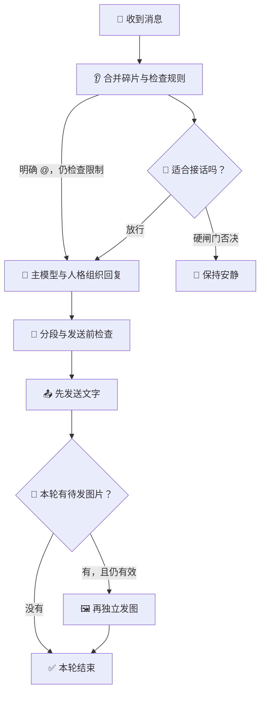

<div align="center">

# 👋 LivingHello

**让机器人先听懂话题，在合适的时候接话。**


[](https://docs.astrbot.app/)
[](CHANGELOG.md)

**简体中文** · [English](README.en.md)

**👂 听懂话题 · 🤔 判断接话 · 💬 整理回复 · 🎨 按需画图**

[🚀 第一次使用](#quick-start) · [🎨 AI 生图](#image-generation) · [❓ 常见问题](#faq)

</div>

LivingHello 是一个 AstrBot 插件。群聊里，它先根据规则和模型判断是否适合接话，再把允许回复的消息交给你配置的主模型与人格。它也能合并连续消息、管理分段与引用、按需看图或生成图片。安装 LivingMemory / LivingEmotion 并开启对应接入后，还能使用历史记忆和当轮情绪。

<a name="features"></a>

## ✨ 能做什么

| 你希望机器人…… | LivingHello 怎么做 |
| --- | --- |
| 🤫 该安静时安静 | 先判断参与是否合适；硬闸门否决后停止主回复生成。 |
| 👂 等你把话说完 | 可合并同一用户在同一会话里的连续消息，再处理一次。 |
| 🖼️ 理解你发的图片 | 配置视觉模型后，按需读图并把观察交给回复模型。 |
| 💬 回复更好读 | 管理段落、多条消息、首条引用与 @；语音使用 AstrBot 原生配置。 |
| 🎨 帮你画图或改图 | 主模型按需调用生图工具，先回文字，再独立发图。 |
| 🧠 记得以前聊过的事 | 可选接入 LivingMemory，在授权范围内召回历史。 |
| 🌙 带着当下情绪说话 | 可选接入 LivingEmotion，读取当轮情绪、关系与聊天可用性。 |
| 🔎 看懂为什么没回复 | 控制台展示判定与请求追踪，可查看接收、生成、工具及发送结果。 |

<a name="quick-start"></a>

## 🚀 第一次使用

> [!TIP]
> 第一次先配置判定模型和对话模型，确认文字聊天可用，再按需开启记忆、情绪或生图。

### ① 安装插件

在 AstrBot 管理面板的插件管理中，通过下面的仓库地址安装。

```text
https://github.com/AKIhunter/astrbot_plugin_livinghello
```

需要 **AstrBot ≥ 4.29.1**。安装后，在插件详情打开 **`guard`**。

### ② 选一个判定模型

进入 **判定设置**，选择成本合适、能稳定输出结果的小模型。先保留默认 **硬闸门 `enforce`** 和阈值 **`65`**。

> [!NOTE]
> 判定模型负责“该不该接话”，主模型负责“具体说什么”。判定模型留空时会跟随会话模型，费用也随它变化。

### ③ 选对话模型与人格

进入 **回复与私聊 → AstrBot配置人格**，核对编辑的配置，选择人格和对话模型，点击底部 **保存更新**。

会话实际使用哪份配置仍由 AstrBot 分配。保存后确认测试会话使用的就是这份配置。

### ④ 看一眼结果

到 **运行概览** 查看最近记录。需要排查时，打开详情，依次看 **接收 → 判断 → 生成 → 工具 → 发送**。

**流程与试跑**可以模拟文字判定；它会调用模型，但不会生成主回复或发送消息。

> [!IMPORTANT]
> 判定、看图、文字试跑、语音和生图都可能产生 API 费用，取决于启用的功能与所选服务。观察模式 `shadow` 仍会继续生成回复。

## 🧭 目录

| 先看这里 | 需要时再看 |
| --- | --- |
| [💬 聊天小剧场](#chat-examples) | [🎨 AI 生图](#image-generation) |
| [🎛️ 控制台与配置](#console) | [🧩 配套插件](#integrations) |
| [🔄 工作流程](#flow) | [❓ 常见问题](#faq) |
| [🧯 使用模式](#modes) | [🛠️ 指令与接口](#commands) |
| [📚 完整文档](#documentation) | [📦 更新日志](#changelog) |

<a name="chat-examples"></a>

## 💬 聊天小剧场

这些是功能示意，实际判断、回复文字和工具调用取决于配置、背景与模型。

### 🤔「这句话需要我接吗？」

| 群里发生了什么 | 机器人会考虑什么 |
| --- | --- |
| 👥 两个人正在聊自己的安排。 | 🤫 是否与我有关？插话是否合适？可能保持安静。 |
| 🙋 有人明确 @ 机器人并提问。 | 👋 原生 @ 有直接回复路径，仍检查名单等限制。 |
| 🖼️ 有人发图，并问图里是什么。 | 👀 使用已配置的图片理解能力，取得观察再回答。 |

### 👂「等一下，我还没说完」

```text
🙋 你    「帮我想个名字」
🙋 你    「是给一只猫」
🙋 你    「橘色的」

🤖 合并后的意思
   「给一只橘猫想个名字」
```

开启碎片合并后，同一用户的续发会重置安静期。默认安静期 **3 秒**，整批最多等 **10 秒**；是否合并私聊由独立开关控制。

### 🎨「画一只窗边的猫」

```text
🙋 你    「画一只坐在窗边的猫」
💬 机器人  简短承接你的请求。  / A short text reply acknowledges the request.
🖼️ 机器人  再单独发送生成的图片。 / The generated image follows as a separate message.
```

这是生图工具成功、主回复已发送且本轮未取消时的顺序。生成失败、超时或回复被取消时，图片可能不会发出。

<a name="modes"></a>

## 🧯 使用模式

| 模式 | 简单理解 | 适合什么时候 |
| --- | --- | --- |
| **`enforce` · 硬闸门** | 判断该安静时，停止主回复生成。 | ✅ 默认，日常使用。 |
| **`shadow` · 观察** | 记录判断，但继续原生生成流程。 | 🔬 对比模型或阈值。 |

硬闸门静默时仍可能已经使用判定 API；图片异常兜底也可能调用模型。观察模式不绕过名单和明确禁聊限制。

<details>
<summary>🔧 群聊、私聊和旧配置</summary>

默认私聊不做参与评分，但名单、明确禁聊状态和发送保护仍生效。原生 @ 有直接放行路径，不保证一定产生小模型评分记录。

普通群消息的主动判定由 `proactive_group_judge` 控制：默认 `whitelist_empty` 在群白名单为空时补判定；`all` 扩展主动判定范围，名单限制仍生效；`off` 沿用 AstrBot 自身的主动回复策略。

当前仅支持 `enforce` 和 `shadow`。旧 `legacy` / `off` 模式值会归一到 `enforce`；要停用插件，请使用 AstrBot 的插件停用功能。

</details>

<a name="console"></a>

## 🎛️ 控制台与配置

**入口**

| 页面 | 在这里做什么 |
| --- | --- |
| 📊 **运行概览** | 看统计、最近判断和请求详情。 |
| 🤔 **判定设置** | 选择判定/视觉模型，调整阈值、背景、预算和时限。 |
| 💬 **回复与私聊** | 设置碎片、引用/@、人格、对话模型、语音、分段和生图。 |
| 🧪 **流程与试跑** | 查看判定流程，用文字样例检查依据。 |

参数旁的 **`?`** 有解释和示例；改动后点击底部 **保存更新**。切页保留草稿，保存失败时先看对应分组的结果。

### 🧷 几个默认值

| 设置 | 默认值 | 大白话 |
| --- | --- | --- |
| 参与模式 | | 判断不合适就不生成主回复。 |
| 接话阈值 | | 是接话合适度，不是事实正确率。 |
| 私聊参与过滤 | 关闭 | 私聊默认跳过评分。 |
| 碎片安静期 | | 续发可以重置等待。 |
| 碎片总等待上限 | | 连续发送也有整批截止点。 |
| 私聊旧答顶替窗口 | | 窗口内新消息可顶替未发旧答。 |
| 回复有效期 | | 默认值；可配置为 `5–300 s`。 |
| AI 生图 | 关闭 | 选好支持生图的 API 后再开启。 |
| 生图每日共享上限 | | 上游请求次数，失败也计数。 |

已保存的配置优先于默认值。完整字段、范围和各类 `0` 的含义见 [配置参考](docs/configuration.md)。

<a name="image-generation"></a>

## 🎨 AI 生图

### 三种“图片功能”，先分清

| 功能 | 例子 |
| --- | --- |
| 👀 **看图** | “这张照片里有什么？” |
| 📝 **文字排版转图** | 把一段回复排版成图片，使用 AstrBot 原生 `t2i`。 |
| 🖌️ **AI 生图** | “画只猫”；或发参考图说“把背景改成夜晚”。 |

### 开启步骤

1. 进入 **回复与私聊 → AI生图（文生图 / 图生图）**。
2. 选择 AstrBot 已注册模型或多 API 路由的**具体上游**，确认该服务确实支持所选生图接口。
3. 核对模型名称、接口、尺寸和每日上限，开启生图，点击 **保存更新**。
4. 主对话模型需要支持工具调用。文生图用文字描述；图生图使用本次消息或引用里的图片。

启用且工具可用时，群聊和私聊都可以提供生图工具，由主模型判断是否调用。成功生成后先发主回复文字，再独立发图；上游提供的实际画法会回传给模型，帮助它理解生成结果。

> [!NOTE]
> 每次请求 1 张图；文生图和图生图共用每日额度，按服务器本地自然日重置。失败、超时、生成后取消都可能已消耗额度；未知结果不会自动重试或补发。

连接复用宿主或路由已配置的地址和密钥，不依赖 BiliBot。[详细设置](docs/usage.md#配置独立ai生图)。

<a name="flow"></a>

## 🔄 工作流程



判定会按需读取背景、记忆或图片。分数够高也要同时满足理解状态和其他规则；发送前还会检查名单、撤回、过期与旧答失效。

回复失败会按错误类别和已启用的配置决定重试、换候选、静默或上报。工具成功与发送成功会分别记录。

更细的分支见 [流程说明](docs/architecture.md) 和 [HTML 图解](docs/flow/index.html)。HTML 在 GitHub 文件页显示源码；下载仓库后，用浏览器打开该文件查看图解。

<a name="integrations"></a>

## 🧩 配套插件

**只装 LivingHello 也能使用。** 需要记忆或情绪时，再安装对应插件并开启接入。

| 组合 | 多了什么 |
| --- | --- |
| | 接话判断、回复管理、媒体与工具交接。 |
| | 在授权会话/人格范围内召回真实历史。 |
| | 当轮情绪、关系和聊天可用性；例如明确睡眠状态可限制聊天。 |
| 👋 + 🧠 + 🌙 **三者一起** | 回复可同时参考历史与情绪，各插件维护自己的数据。 |

接入位置：**AstrBot → 插件 → LivingHello → 配置 → 接入 LivingMemory / 接入 LivingEmotion**。两个开关默认关闭，安装插件本身不会自动开启联动。

<details>
<summary>🔌 记忆写入、从绫与模型路由</summary>

**记忆：** Hello 的接入开关控制召回；关闭它不会关闭 Memory 自身的归档或写工具。长期写入需要实际启用写工具，由主模型成功调用，不能把“计划写入”当作已保存。

**从绫：** 保留感知与固定人格兼容；动态情绪、关系和记忆使用统一功能耦合。[配套说明](docs/architecture.md#从绫配套)。

**多 API 路由：** 使用已注册 Provider 或支持的具体上游；看图、生图、语音和对话模型的能力需要分别核对。

</details>

<a name="faq"></a>

## ❓ 常见问题

<details>
<summary>🙋 @ 了机器人，为什么没有评分？</summary>

原生 @ 可以直接放行，不伪造小模型评分记录。先看请求是否接收、是否生成及是否发送。

</details>

<details>
<summary>🤫 降低阈值，为什么还是不回复？</summary>

阈值只是一项条件。背景不足、明确停口、名单、预算、冷却或过期也可能阻止回复。打开请求详情，先看具体原因。

</details>

<details>
<summary>💬 明明开了分段，为什么还是一条？</summary>

“仅对模型结果分段”控制模型组织段落，“启用分段回复”控制发送多条。还要核对会话使用的原生配置及平台限制。

[分段示例](docs/usage.md#设置分段回复)

</details>

<details>
<summary>⏳ 私聊新消息，会把旧回复顶替吗？</summary>

默认从旧消息到达时刻起算，15 秒内收到新消息，可丢弃尚未发送的旧回复并停止剩余气泡；已发出的不会自动回收。窗口外旧回复仍可发送，但回复有效期继续生效。窗口设 `0` 关闭顶替；默认只作用于私聊。

</details>

<details>
<summary>🎨 额度扣了，为什么没收到图片？</summary>

额度统计的是已请求上游的次数。上游失败、超时或生成后本轮取消，都可能计数。查请求追踪中的绘图 API 次数和图片发送结果，确认后再决定是否重新请求。

</details>

<details>
<summary>🖼️ 模型能看图，是不是也能画图？</summary>

不一定。看图、生图和文字排版转图是三种能力；生图还需要兼容的接口和支持工具调用的主对话模型。

</details>

<details>
<summary>🧠 开了记忆接入，为什么还是不记得？</summary>

核对 LivingMemory 是否激活、作用域是否允许、是否真的有相关历史，以及召回是否成功。只有当轮情绪或关系不能证明已经召回往事。

</details>

<details>
<summary>🔎 日志从哪里看？</summary>

在 **运行概览** 找到最近记录，复制 `request_id`，打开详情查看接收、判断、生成、工具与发送。工具已注册不等于本轮调用，放行不等于发送完成。

[按请求 ID 排查](docs/usage.md#按请求id排查)

</details>

<a name="compatibility"></a>

## 🧷 兼容性与数据

- **AstrBot ≥ 4.29.1**；语音、图片、引用和 @ 的实际效果取决于 Provider 与平台能力。
- 正式名称为 **LivingHello**，当前插件 ID 为 `astrbot_plugin_LivingHello`。内部兼容标识可能保留 `at_guard`，请勿仅因名称不同就手动删除旧配置或数据。
- 判定记录可能包含聊天正文、背景和模型输入；提交问题时只附脱敏后的最小案例。
- 生图连接密钥复用宿主或路由配置，不返回页面；每日生图上限设 `0` 可禁止生图。
- 离线回归说明代码路径得到验证，不代表真实群聊判断必然准确，也不代表固定的费用节省比例。

<a name="commands"></a>

## 🛠️ 使用指令与接口

| 入口 | 用途 |
| --- | --- |
| `/智能过滤统计` | 查看当前模式与今日统计，命令前缀跟随 AstrBot 设置。 |
| 插件详情 | 配置、记录和文字试跑。 |
| | 提供给主模型的生图工具，不是手动聊天指令。 |

<details>
<summary>🧑‍💻 给开发者的接口</summary>

| 接口 | 用途 |
| --- | --- |
| | 可选打分，返回 `{"score": 0..100}` 或 `None`；使用判定模型。 |
| | 读取目标配置的固定人格。 |
| | 查询插件接入状态与共享契约。 |

开发、路由及离线验证见 [开发与维护](docs/development.md)。

</details>

<a name="changelog"></a>

## 📦 更新日志

当前版本 **2.7.5**：修复普通群聊判定入口、私聊图片摘要、历史记忆补查及旧图授权检查。当前仓库也包含“模型自主选择生图、先文字后图片、实际画法回传”和 LivingMemory 原生作用域适配。

[查看完整版本记录](CHANGELOG.md)

<a name="documentation"></a>

## 📚 完整文档

README 提供中英双语入门；下面的详细文档主要为中文，代码字段保留原名。

| 想继续了解 | 文档 |
| --- | --- |
| 操作与排查 | [使用指南](docs/usage.md) |
| 字段、范围与默认值 | [配置参考](docs/configuration.md) |
| 判定和发送逻辑 | [流程说明](docs/architecture.md) |
| 四种插件组合 | [配套组合](docs/integrations-and-flow.md) |
| 浏览器图解 | [HTML 图解](docs/flow/index.html) |
| 合成场景验证 | [验证报告](docs/validation-20261112.md) |
| 开发与维护 | [开发说明](docs/development.md) |
| 所有文档 | [文档索引](docs/README.md) |

<div align="center">

**👋 Hello，先听懂，再接话。**

</div>
