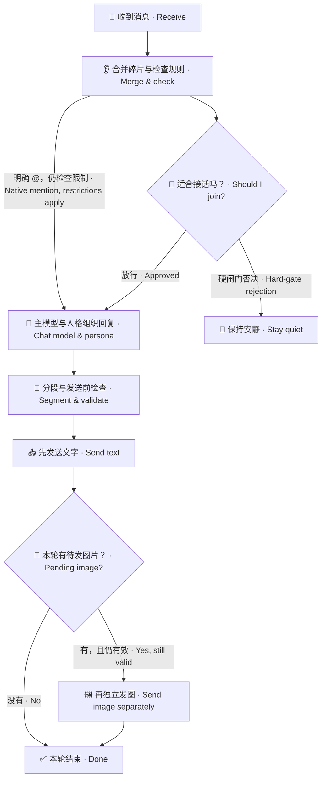

<div align="center">

# 👋 LivingHello

**让机器人先听懂话题，在合适的时候接话。**

**Help your bot follow the conversation and respond when it makes sense.**


[](https://docs.astrbot.app/)
[](CHANGELOG.md)
[](#quick-start)

**👂 听懂话题 · 🤔 判断接话 · 💬 整理回复 · 🎨 按需画图**

**Follow the topic · Decide when to join · Organize replies · Draw when needed**

[🚀 第一次使用 / Quick start](#quick-start) · [🎨 AI 生图 / Image generation](#image-generation) · [❓ 常见问题 / FAQ](#faq)

</div>

LivingHello 是一个 AstrBot 插件。群聊里，它先根据规则和模型判断是否适合接话，再把允许回复的消息交给你配置的主模型与人格。它也能合并连续消息、管理分段与引用、按需看图或生成图片。安装 LivingMemory / LivingEmotion 并开启对应接入后，还能使用历史记忆和当轮情绪。

LivingHello is an AstrBot plugin. In group chats, it uses rules and a model to decide whether to join, then passes approved messages to your configured chat model and persona. It can combine consecutive messages, manage reply segments and quotes, and understand or generate images. Optional LivingMemory and LivingEmotion integrations add past memories and the current emotional state.

<a name="features"></a>

## ✨ 能做什么 / What can it do?

| 你希望机器人…… / You want your bot to… | LivingHello 怎么做 / How LivingHello helps |
| --- | --- |
| 🤫 该安静时安静<br>Stay quiet when appropriate | 先判断参与是否合适；硬闸门否决后停止主回复生成。<br>Check whether participation makes sense; a hard-gate rejection stops the main reply. |
| 👂 等你把话说完<br>Let you finish speaking | 可合并同一用户在同一会话里的连续消息，再处理一次。<br>Optionally combine consecutive messages from the same user in the same conversation. |
| 🖼️ 理解你发的图片<br>Understand shared images | 配置视觉模型后，按需读图并把观察交给回复模型。<br>Use a configured vision model when needed and pass its observations to the reply model. |
| 💬 回复更好读<br>Make replies easier to read | 管理段落、多条消息、首条引用与 @；语音使用 AstrBot 原生配置。<br>Manage paragraphs, message segments, first-message quotes and mentions; speech uses native AstrBot settings. |
| 🎨 帮你画图或改图<br>Generate or edit images | 主模型按需调用生图工具，先回文字，再独立发图。<br>The main model can call an image tool; the text reply is sent before a separate image message. |
| 🧠 记得以前聊过的事<br>Use past conversations | 可选接入 LivingMemory，在授权范围内召回历史。<br>Optionally use LivingMemory to retrieve history within the authorized scope. |
| 🌙 带着当下情绪说话<br>Use the current emotional state | 可选接入 LivingEmotion，读取当轮情绪、关系与聊天可用性。<br>Optionally use LivingEmotion for current emotion, relationships and chat availability. |
| 🔎 看懂为什么没回复<br>Understand why it stayed quiet | 控制台展示判定与请求追踪，可查看接收、生成、工具及发送结果。<br>The console shows decisions and traces for receiving, generation, tools and delivery. |

<a name="quick-start"></a>

## 🚀 第一次使用 / Quick start

> [!TIP]
> 第一次先配置判定模型和对话模型，确认文字聊天可用，再按需开启记忆、情绪或生图。
>
> Start with the decision model and chat model. Confirm text chat works, then enable memory, emotion or image generation as needed.

### ① 安装插件 / Install

在 AstrBot 管理面板的插件管理中，通过下面的仓库地址安装。

In AstrBot’s plugin manager, install the plugin using this repository URL:

```text
https://github.com/AKIhunter/astrbot_plugin_livinghello
```

需要 **AstrBot ≥ 4.29.1**。安装后，在插件详情打开 **`guard`**。

Requires **AstrBot ≥ 4.29.1**. After installation, open **`guard`** in the plugin details.

### ② 选一个判定模型 / Choose a decision model

进入 **判定设置**，选择成本合适、能稳定输出结果的小模型。先保留默认 **硬闸门 `enforce`** 和阈值 **`65`**。

Open **判定设置 / Decision settings** and choose an affordable model that returns reliable results. Start with the default **hard gate `enforce`** and threshold **`65`**.

> [!NOTE]
> 判定模型负责“该不该接话”，主模型负责“具体说什么”。判定模型留空时会跟随会话模型，费用也随它变化。
>
> The decision model answers “Should I join?” The chat model writes the reply. Leaving the decision model empty uses the conversation’s model, including its pricing.

### ③ 选对话模型与人格 / Choose the chat model and persona

进入 **回复与私聊 → AstrBot配置人格**，核对编辑的配置，选择人格和对话模型，点击底部 **保存更新**。

Open **回复与私聊 / Replies & private chats → AstrBot配置人格 / AstrBot configuration & persona**. Check the configuration you are editing, select a persona and chat model, then click **保存更新 / Save updates**.

会话实际使用哪份配置仍由 AstrBot 分配。保存后确认测试会话使用的就是这份配置。

AstrBot still assigns configurations to conversations. Make sure your test conversation uses the configuration you just saved.

### ④ 看一眼结果 / Check the result

到 **运行概览** 查看最近记录。需要排查时，打开详情，依次看 **接收 → 判断 → 生成 → 工具 → 发送**。

Open **运行概览 / Overview** to see recent records. For troubleshooting, open a record and follow **receive → decide → generate → tools → deliver**.

**流程与试跑**可以模拟文字判定；它会调用模型，但不会生成主回复或发送消息。

**流程与试跑 / Flow & test run** can simulate a text decision. It calls a model but does not generate the main reply or send messages.

> [!IMPORTANT]
> 判定、看图、文字试跑、语音和生图都可能产生 API 费用，取决于启用的功能与所选服务。观察模式 `shadow` 仍会继续生成回复。
>
> Decisions, vision, test runs, speech and image generation may incur API costs, depending on enabled features and providers. Observation mode `shadow` still continues reply generation.

## 🧭 目录 / Contents

| 先看这里 / Start here | 需要时再看 / Explore when needed |
| --- | --- |
| [💬 聊天小剧场 / Chat examples](#chat-examples) | [🎨 AI 生图 / Image generation](#image-generation) |
| [🎛️ 控制台与配置 / Console & settings](#console) | [🧩 配套插件 / Integrations](#integrations) |
| [🔄 工作流程 / How it works](#flow) | [❓ 常见问题 / FAQ](#faq) |
| [🧯 使用模式 / Modes](#modes) | [🛠️ 指令与接口 / Commands & interfaces](#commands) |
| [📚 完整文档 / Documentation](#documentation) | [📦 更新日志 / Changelog](#changelog) |

<a name="chat-examples"></a>

## 💬 聊天小剧场 / A few chat examples

这些是功能示意，实际判断、回复文字和工具调用取决于配置、背景与模型。

These examples illustrate the features. Actual decisions, wording and tool calls depend on your settings, context and models.

### 🤔「这句话需要我接吗？」 / “Should I join this conversation?”

| 群里发生了什么 / What happens in the group | 机器人会考虑什么 / What the bot considers |
| --- | --- |
| 👥 两个人正在聊自己的安排。<br>Two people are discussing their own plans. | 🤫 是否与我有关？插话是否合适？可能保持安静。<br>Is this relevant to me? Would joining help? It may stay quiet. |
| 🙋 有人明确 @ 机器人并提问。<br>Someone mentions the bot and asks a question. | 👋 原生 @ 有直接回复路径，仍检查名单等限制。<br>A native mention has a direct reply path, subject to list restrictions. |
| 🖼️ 有人发图，并问图里是什么。<br>Someone shares an image and asks what it shows. | 👀 使用已配置的图片理解能力，取得观察再回答。<br>Use the configured image-understanding capability before answering. |

### 👂「等一下，我还没说完」 / “Wait, I’m not finished”

```text
🙋 你 / You    「帮我想个名字」 / “Help me think of a name.”
🙋 你 / You    「是给一只猫」   / “It’s for a cat.”
🙋 你 / You    「橘色的」       / “An orange one.”

🤖 合并后的意思 / Combined meaning
   「给一只橘猫想个名字」 / “Suggest a name for an orange cat.”
```

开启碎片合并后，同一用户的续发会重置安静期。默认安静期 **3 秒**，整批最多等 **10 秒**；是否合并私聊由独立开关控制。

With fragment merging enabled, another message from the same user resets the quiet period. Defaults are **3 seconds** of quiet and a **10-second** batch limit. Private-chat merging has its own switch.

### 🎨「画一只窗边的猫」 / “Draw a cat by the window”

```text
🙋 你 / You    「画一只坐在窗边的猫」 / “Draw a cat sitting by a window.”
💬 机器人 / Bot  简短承接你的请求。  / A short text reply acknowledges the request.
🖼️ 机器人 / Bot  再单独发送生成的图片。 / The generated image follows as a separate message.
```

这是生图工具成功、主回复已发送且本轮未取消时的顺序。生成失败、超时或回复被取消时，图片可能不会发出。

This is the order when generation succeeds, the main reply is sent and the turn remains valid. Generation failures, timeouts or a cancelled reply may prevent image delivery.

<a name="modes"></a>

## 🧯 使用模式 / Modes

| 模式 / Mode | 简单理解 / What it means | 适合什么时候 / When to use it |
| --- | --- | --- |
| **`enforce` · 硬闸门 / Hard gate** | 判断该安静时，停止主回复生成。<br>Stop the main reply when the decision is to remain quiet. | ✅ 默认，日常使用。<br>Default for everyday use. |
| **`shadow` · 观察 / Observe** | 记录判断，但继续原生生成流程。<br>Record the decision while continuing native generation. | 🔬 对比模型或阈值。<br>Compare models or thresholds. |

硬闸门静默时仍可能已经使用判定 API；图片异常兜底也可能调用模型。观察模式不绕过名单和明确禁聊限制。

A hard-gate rejection may still have used the decision API; vision fallback may also call a model. Observation mode does not bypass list restrictions or explicit chat blocks.

<details>
<summary>🔧 群聊、私聊和旧配置 / Group chats, private chats and older settings</summary>

默认私聊不做参与评分，但名单、明确禁聊状态和发送保护仍生效。原生 @ 有直接放行路径，不保证一定产生小模型评分记录。

Private chats skip participation scoring by default, while list restrictions, explicit chat blocks and delivery checks remain active. Native mentions have a direct path and may not produce a decision-model score.

普通群消息的主动判定由 `proactive_group_judge` 控制：默认 `whitelist_empty` 在群白名单为空时补判定；`all` 扩展主动判定范围，名单限制仍生效；`off` 沿用 AstrBot 自身的主动回复策略。

Proactive group decisions are controlled by `proactive_group_judge`: the default `whitelist_empty` adds decisions when the group whitelist is empty; `all` broadens proactive evaluation while retaining list restrictions; `off` follows AstrBot’s own proactive reply policy.

当前仅支持 `enforce` 和 `shadow`。旧 `legacy` / `off` 模式值会归一到 `enforce`；要停用插件，请使用 AstrBot 的插件停用功能。

Only `enforce` and `shadow` are supported. Older `legacy` / `off` mode values normalize to `enforce`. To disable the plugin, use AstrBot’s plugin controls.

</details>

<a name="console"></a>

## 🎛️ 控制台与配置 / Console & settings

**入口 / Entry：AstrBot → 插件 / Plugins → LivingHello → 插件详情 / Details → `guard`**

| 页面 / Page | 在这里做什么 / What to do here |
| --- | --- |
| 📊 **运行概览 / Overview** | 看统计、最近判断和请求详情。<br>View statistics, recent decisions and request details. |
| 🤔 **判定设置 / Decision settings** | 选择判定/视觉模型，调整阈值、背景、预算和时限。<br>Choose decision/vision models; adjust thresholds, context, budgets and time limits. |
| 💬 **回复与私聊 / Replies & private chats** | 设置碎片、引用/@、人格、对话模型、语音、分段和生图。<br>Configure fragments, quotes/mentions, persona, chat models, speech, segments and image generation. |
| 🧪 **流程与试跑 / Flow & test run** | 查看判定流程，用文字样例检查依据。<br>Explore the decision flow and inspect reasoning with a text example. |

参数旁的 **`?`** 有解释和示例；改动后点击底部 **保存更新**。切页保留草稿，保存失败时先看对应分组的结果。

The **`?`** beside a setting provides explanations and examples. Click **保存更新 / Save updates** after editing. Switching pages keeps drafts; if saving fails, check the affected section’s result.

### 🧷 几个默认值 / Useful defaults

| 设置 / Setting | 默认值 / Default | 大白话 / In plain language |
| --- | --- | --- |
| 参与模式 / Participation mode | `enforce` | 判断不合适就不生成主回复。<br>A rejected decision stops the main reply. |
| 接话阈值 / Participation threshold | `65` | 是接话合适度，不是事实正确率。<br>A participation score, not factual accuracy. |
| 私聊参与过滤 / Private-chat scoring | 关闭 / Off | 私聊默认跳过评分。<br>Private chats skip scoring by default. |
| 碎片安静期 / Fragment quiet period | `3 s` | 续发可以重置等待。<br>Another message can reset the wait. |
| 碎片总等待上限 / Batch wait limit | `10 s` | 连续发送也有整批截止点。<br>The batch has a deadline even with continued messages. |
| 私聊旧答顶替窗口 / Private reply replacement window | `15 s` | 窗口内新消息可顶替未发旧答。<br>A new message within the window can replace an unsent old reply. |
| 回复有效期 / Reply lifetime | `30 s` | 默认值；可配置为 `5–300 s`。<br>The default; configurable from `5–300 s`. |
| AI 生图 / AI image generation | 关闭 / Off | 选好支持生图的 API 后再开启。<br>Choose a compatible image API before enabling it. |
| 生图每日共享上限 / Shared daily image limit | `20` | 上游请求次数，失败也计数。<br>Counts upstream requests, including failures. |

已保存的配置优先于默认值。完整字段、范围和各类 `0` 的含义见 [配置参考 / Configuration reference](docs/configuration.md)。

Saved settings take precedence over defaults. See the [configuration reference](docs/configuration.md) for all fields, ranges and meanings of `0`.

<a name="image-generation"></a>

## 🎨 AI 生图 / AI image generation

### 三种“图片功能”，先分清 / Three different image features

| 功能 / Feature | 例子 / Example |
| --- | --- |
| 👀 **看图 / Understand an image** | “这张照片里有什么？”<br>“What is in this photo?” |
| 📝 **文字排版转图 / Render text as an image** | 把一段回复排版成图片，使用 AstrBot 原生 `t2i`。<br>Turn a text reply into an image using AstrBot’s native `t2i`. |
| 🖌️ **AI 生图 / Generate or edit an image** | “画只猫”；或发参考图说“把背景改成夜晚”。<br>“Draw a cat”; or attach a reference and ask to change the background to night. |

### 开启步骤 / Enable image generation

1. 进入 **回复与私聊 → AI生图（文生图 / 图生图）**。<br>Open **回复与私聊 / Replies & private chats → AI生图（文生图 / 图生图） / AI image generation**.
2. 选择 AstrBot 已注册模型或多 API 路由的**具体上游**，确认该服务确实支持所选生图接口。<br>Select a registered AstrBot model or a **specific upstream** from the multi-API router. Confirm that the service supports your chosen image interface.
3. 核对模型名称、接口、尺寸和每日上限，开启生图，点击 **保存更新**。<br>Check the model name, interface, size and daily limit, enable generation, then click **Save updates**.
4. 主对话模型需要支持工具调用。文生图用文字描述；图生图使用本次消息或引用里的图片。<br>The main chat model needs tool-calling support. Describe an image for generation; use an image from the current message or its quote for editing.

启用且工具可用时，群聊和私聊都可以提供生图工具，由主模型判断是否调用。成功生成后先发主回复文字，再独立发图；上游提供的实际画法会回传给模型，帮助它理解生成结果。

When enabled and available, the image tool can be provided in both group and private chats. The main model decides whether to call it. After successful generation, the main text reply is sent before a separate image message. Any revised prompt supplied by the upstream is returned to the model to help it understand what was generated.

> [!NOTE]
> 每次请求 1 张图；文生图和图生图共用每日额度，按服务器本地自然日重置。失败、超时、生成后取消都可能已消耗额度；未知结果不会自动重试或补发。
>
> Each request generates one image. Generation and editing share a daily limit that resets on the server’s local calendar day. Failures, timeouts and cancellations after generation may consume the limit; unknown results are not retried or resent automatically.

连接复用宿主或路由已配置的地址和密钥，不依赖 BiliBot。[详细设置 / Detailed setup](docs/usage.md#配置独立ai生图)。

Connections reuse the host or router’s configured endpoint and credentials. BiliBot is not required. [Detailed setup](docs/usage.md#配置独立ai生图).

<a name="flow"></a>

## 🔄 工作流程 / How it works



判定会按需读取背景、记忆或图片。分数够高也要同时满足理解状态和其他规则；发送前还会检查名单、撤回、过期与旧答失效。

The decision stage can use context, memories or images when needed. A high score still needs a valid understanding state and other checks. Before delivery, the plugin rechecks lists, recalls, expiry and superseded replies.

回复失败会按错误类别和已启用的配置决定重试、换候选、静默或上报。工具成功与发送成功会分别记录。

Reply failures are handled by error category and enabled settings: retry, rotate candidates, remain quiet or report. Tool success and delivery success are recorded separately.

更细的分支见 [流程说明 / Architecture](docs/architecture.md) 和 [HTML 图解 / HTML flow guide](docs/flow/index.html)。HTML 在 GitHub 文件页显示源码；下载仓库后，用浏览器打开该文件查看图解。

See [Architecture](docs/architecture.md) and the [HTML flow guide](docs/flow/index.html) for detailed branches. GitHub’s file page shows HTML source; download the repository and open the file in a browser to view the guide.

<a name="integrations"></a>

## 🧩 配套插件 / Optional integrations

**只装 LivingHello 也能使用。** 需要记忆或情绪时，再安装对应插件并开启接入。

**LivingHello works on its own.** Install the optional plugins and enable their integrations when you need memory or emotion.

| 组合 / Setup | 多了什么 / What it adds |
| --- | --- |
| 👋 **LivingHello** | 接话判断、回复管理、媒体与工具交接。<br>Participation decisions, reply management, media and tool handoff. |
| 👋 + 🧠 **[LivingMemory](https://github.com/AKIhunter/astrbot_plugin_livingmemory)** | 在授权会话/人格范围内召回真实历史。<br>Retrieve real history within authorized conversation/persona scopes. |
| 👋 + 🌙 **[LivingEmotion](https://github.com/AKIhunter/astrbot_plugin_livingemotion)** | 当轮情绪、关系和聊天可用性；例如明确睡眠状态可限制聊天。<br>Current emotion, relationships and chat availability; an explicit sleeping state can block chat. |
| 👋 + 🧠 + 🌙 **三者一起 / All three** | 回复可同时参考历史与情绪，各插件维护自己的数据。<br>Replies can use both history and emotion; each plugin maintains its own data. |

接入位置：**AstrBot → 插件 → LivingHello → 配置 → 接入 LivingMemory / 接入 LivingEmotion**。两个开关默认关闭，安装插件本身不会自动开启联动。

Integration settings: **AstrBot → Plugins → LivingHello → Configuration → 接入 LivingMemory / 接入 LivingEmotion**. Both switches default to off; installing a plugin alone does not enable the integration.

<details>
<summary>🔌 记忆写入、从绫与模型路由 / Memory writes, Congling and model routing</summary>

**记忆：** Hello 的接入开关控制召回；关闭它不会关闭 Memory 自身的归档或写工具。长期写入需要实际启用写工具，由主模型成功调用，不能把“计划写入”当作已保存。

**Memory:** Hello’s integration switch controls retrieval. Turning it off does not disable Memory’s own archiving or write tools. A long-term write requires an enabled tool and a successful call by the main model; a planned write is not a saved memory.

**从绫：** 保留感知与固定人格兼容；动态情绪、关系和记忆使用统一功能耦合。[配套说明](docs/architecture.md#从绫配套)。

**Congling:** Perception and fixed-persona compatibility remain; dynamic emotion, relationships and memory use the shared integration controls. [Integration notes](docs/architecture.md#从绫配套).

**多 API 路由：** 使用已注册 Provider 或支持的具体上游；看图、生图、语音和对话模型的能力需要分别核对。

**Multi-API routing:** Use registered providers or supported specific upstreams. Verify vision, image generation, speech and chat capabilities separately.

</details>

<a name="faq"></a>

## ❓ 常见问题 / FAQ

<details>
<summary>🙋 @ 了机器人，为什么没有评分？ / Why is there no score after mentioning the bot?</summary>

原生 @ 可以直接放行，不伪造小模型评分记录。先看请求是否接收、是否生成及是否发送。

A native mention can use the direct path without a decision-model score. Check the request’s receive, generation and delivery stages instead.

</details>

<details>
<summary>🤫 降低阈值，为什么还是不回复？ / Why is it still quiet after lowering the threshold?</summary>

阈值只是一项条件。背景不足、明确停口、名单、预算、冷却或过期也可能阻止回复。打开请求详情，先看具体原因。

The threshold is only one condition. Missing context, an explicit request to stop, list restrictions, budgets, cooldowns or expiry may also block a reply. Open the request details and check the reason first.

</details>

<details>
<summary>💬 明明开了分段，为什么还是一条？ / Why does a segmented reply arrive as one message?</summary>

“仅对模型结果分段”控制模型组织段落，“启用分段回复”控制发送多条。还要核对会话使用的原生配置及平台限制。

“仅对模型结果分段” controls how the model organizes paragraphs. “启用分段回复” controls sending multiple messages. Also check the conversation’s native configuration and platform limits.

[分段示例 / Segmentation examples](docs/usage.md#设置分段回复)

</details>

<details>
<summary>⏳ 私聊新消息，会把旧回复顶替吗？ / Can a new private message replace an older reply?</summary>

默认从旧消息到达时刻起算，15 秒内收到新消息，可丢弃尚未发送的旧回复并停止剩余气泡；已发出的不会自动回收。窗口外旧回复仍可发送，但回复有效期继续生效。窗口设 `0` 关闭顶替；默认只作用于私聊。

By default, a new message within 15 seconds of the old message’s arrival can replace the unsent old reply and stop remaining segments. Already sent messages are not recalled. Outside that window, the old reply may still be sent, subject to its lifetime. Set the window to `0` to disable replacement; private chats are the default scope.

</details>

<details>
<summary>🎨 额度扣了，为什么没收到图片？ / Why was quota used without an image arriving?</summary>

额度统计的是已请求上游的次数。上游失败、超时或生成后本轮取消，都可能计数。查请求追踪中的绘图 API 次数和图片发送结果，确认后再决定是否重新请求。

The limit counts requests to the upstream. Failures, timeouts or cancellation after generation may still count. Check image API calls and delivery results in the request trace before deciding whether to request again.

</details>

<details>
<summary>🖼️ 模型能看图，是不是也能画图？ / Does a vision model also generate images?</summary>

不一定。看图、生图和文字排版转图是三种能力；生图还需要兼容的接口和支持工具调用的主对话模型。

Not necessarily. Image understanding, generation and text rendering are separate capabilities. Generation also needs a compatible API and a main chat model that supports tool calls.

</details>

<details>
<summary>🧠 开了记忆接入，为什么还是不记得？ / Why does it forget things after enabling memory?</summary>

核对 LivingMemory 是否激活、作用域是否允许、是否真的有相关历史，以及召回是否成功。只有当轮情绪或关系不能证明已经召回往事。

Check whether LivingMemory is active, the scope permits access, relevant history exists and retrieval succeeded. Current emotion or relationships alone do not prove that past memories were retrieved.

</details>

<details>
<summary>🔎 日志从哪里看？ / Where do I find the logs?</summary>

在 **运行概览** 找到最近记录，复制 `request_id`，打开详情查看接收、判断、生成、工具与发送。工具已注册不等于本轮调用，放行不等于发送完成。

Find a recent record in **Overview**, copy its `request_id`, and inspect receiving, decisions, generation, tools and delivery. A registered tool does not mean it was called; approval does not mean delivery completed.

[按请求 ID 排查 / Troubleshoot by request ID](docs/usage.md#按请求id排查)

</details>

<a name="compatibility"></a>

## 🧷 兼容性与数据 / Compatibility & data

- **AstrBot ≥ 4.29.1**；语音、图片、引用和 @ 的实际效果取决于 Provider 与平台能力。<br>**AstrBot ≥ 4.29.1**; speech, images, quotes and mentions depend on provider and platform capabilities.
- 正式名称为 **LivingHello**，当前插件 ID 为 `astrbot_plugin_LivingHello`。内部兼容标识可能保留 `at_guard`，请勿仅因名称不同就手动删除旧配置或数据。<br>The public name is **LivingHello**, with plugin ID `astrbot_plugin_LivingHello`. Internal compatibility identifiers may retain `at_guard`; do not delete older settings or data just because a name differs.
- 判定记录可能包含聊天正文、背景和模型输入；提交问题时只附脱敏后的最小案例。<br>Decision records may contain chat text, context and model inputs. Share only a minimal, redacted example when reporting issues.
- 生图连接密钥复用宿主或路由配置，不返回页面；每日生图上限设 `0` 可禁止生图。<br>Image credentials are reused from host/router settings and are not returned to the UI. Set the daily image limit to `0` to disable image generation.
- 离线回归说明代码路径得到验证，不代表真实群聊判断必然准确，也不代表固定的费用节省比例。<br>Offline regression verifies code paths, not guaranteed accuracy in real conversations or a fixed cost-saving percentage.

<a name="commands"></a>

## 🛠️ 使用指令与接口 / Commands & interfaces

| 入口 / Entry | 用途 / Purpose |
| --- | --- |
| `/智能过滤统计` | 查看当前模式与今日统计，命令前缀跟随 AstrBot 设置。<br>Show the current mode and today’s statistics; use AstrBot’s configured command prefix. |
| 插件详情 / Plugin details → `guard` | 配置、记录和文字试跑。<br>Settings, records and text test runs. |
| `livinghello_generate_image` | 提供给主模型的生图工具，不是手动聊天指令。<br>An image tool for the main model, not a manual chat command. |

<details>
<summary>🧑‍💻 给开发者的接口 / Developer interfaces</summary>

| 接口 / Interface | 用途 / Purpose |
| --- | --- |
| `at_guard_score(text)` | 可选打分，返回 `{"score": 0..100}` 或 `None`；使用判定模型。<br>Optional scoring; returns `{"score": 0..100}` or `None` and uses the decision model. |
| `get_fixed_native_persona_id(umo)` | 读取目标配置的固定人格。<br>Read the fixed persona for a target configuration. |
| `get_function_coupling()` | 查询插件接入状态与共享契约。<br>Inspect integration status and shared contracts. |

开发、路由及离线验证见 [开发与维护 / Development & maintenance](docs/development.md)。

</details>

<a name="changelog"></a>

## 📦 更新日志 / Changelog

当前版本 **2.7.5**：修复普通群聊判定入口、私聊图片摘要、历史记忆补查及旧图授权检查。当前仓库也包含“模型自主选择生图、先文字后图片、实际画法回传”和 LivingMemory 原生作用域适配。

Current version **2.7.5** fixes the ordinary group-message decision path, private-chat image summaries, history retrieval and historical-image authorization. The current repository also includes model-selected image generation, text-before-image delivery, revised-prompt feedback and native LivingMemory scope integration.

[查看完整版本记录 / Read the full changelog](CHANGELOG.md)

<a name="documentation"></a>

## 📚 完整文档 / Documentation

README 提供中英双语入门；下面的详细文档主要为中文，代码字段保留原名。

This README provides a bilingual introduction. The detailed guides below are mainly in Chinese; code identifiers retain their original names.

| 想继续了解 / Learn more about | 文档 / Guide |
| --- | --- |
| 操作与排查 / Setup & troubleshooting | [使用指南 / Usage](docs/usage.md) |
| 字段、范围与默认值 / Fields, ranges & defaults | [配置参考 / Configuration](docs/configuration.md) |
| 判定和发送逻辑 / Decision & delivery logic | [流程说明 / Architecture](docs/architecture.md) |
| 四种插件组合 / Four integration setups | [配套组合 / Integrations](docs/integrations-and-flow.md) |
| 浏览器图解 / Browser flow diagrams | [HTML 图解 / HTML guide](docs/flow/index.html) |
| 合成场景验证 / Synthetic scenario validation | [验证报告 / Validation](docs/validation-20261112.md) |
| 开发与维护 / Development & maintenance | [开发说明 / Development](docs/development.md) |
| 所有文档 / All guides | [文档索引 / Documentation index](docs/README.md) |

---

<div align="center">

**👋 Hello，先听懂，再接话。 / Listen first. Join thoughtfully.**

</div>
