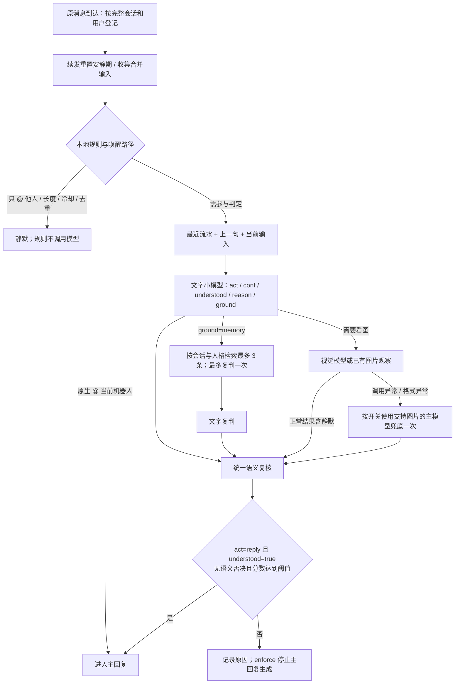
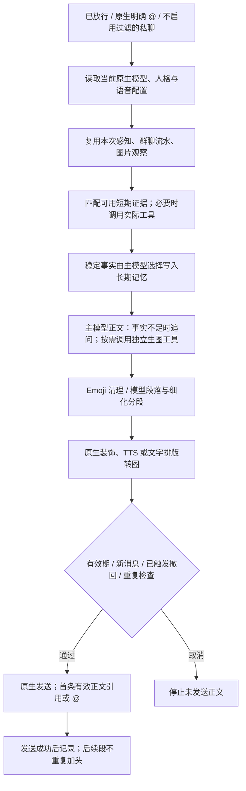
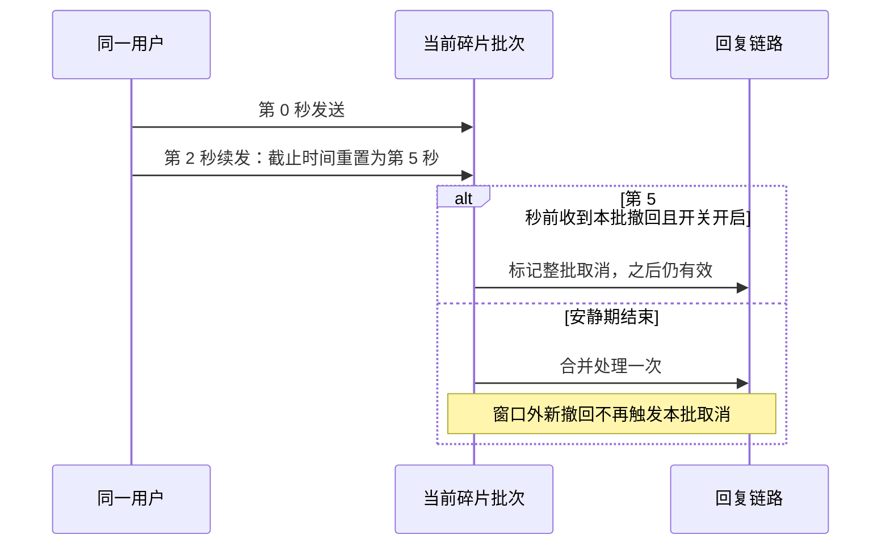

# 流程与集成说明

面向希望理解执行链路的使用者和配套开发者。当前实现依据 [main.py](../main.py)、[gate/guard_engine.py](../gate/guard_engine.py) 及各 `guard_*` 模块。生图和回执部分于 2026-11-28 按 2.10.8 核对。完整白话分支见 [HTML 图解](flow/index.html)，四种接入组合见 [集成说明](integrations-and-flow.md)，历史反例见 [更新日志](../CHANGELOG.md)。钩子、缓存、超时或配套约定改变时更新；以下图不能代替部署状态验证。

本地回复兜底每次调用读取LH的 `reply_primary_timeout_seconds`，缺项默认15秒，整数夹取至1–60秒。主模型在此时限内无有效输出时取消请求，复核既有保护后直接进入配置的回退模型；流式空心跳不延长等待，有效内容后保留从调用开始计算的60秒完成预算。回退模型维持60秒预算，工具步骤共享重试额度，已输出内容和已尝试发送不重放。[完整兜底链路](reply_fallback.md)。

图片入口先刷新平台链接，并行获取OCR与有界下载，下载内容通过像素准入后才交视觉模型。
OCR只提供文字证据，下载失败不猜画面。解码槽位随实际线程释放，达到两份并发时立即省略。
回复先按原标点分段，再在每段内有预算地保护技术内容、清理聊天标点；禁忌词后处理不跨入技术片段。
普通发送与 `send_message_to_user` 的 `plain` 正文使用同一清理规则。[具体边界](boundary-safety.md)。

非流式正文先由 `deduplicate_before_decoration(priority=sys.maxsize)` 在外部装饰插件合并 Plain 前去重；比较键忽略聊天标点与空白，完整句边界允许句号位置变化。`recheck_before_send(priority=-sys.maxsize)` 保留最终分段，以包含 LE 追加的晚安；媒体和单份正文内部重复受原有保护。[去重链路](reply-merge-dedup.md)。

## 判定流程



明确 @ 有直接放行路径，仍保留碎片等待和后续发送检查。纯文字称呼或引用唤醒在开启聚合时可对完整输入判定，后续“不用回了”可以影响结论。预算、总时限及配套可用性约束整个补查流程；正常视觉静默不会走主模型兜底。

背景不足时不靠提高分数放行。互聊、停口、已答、无贡献等语义否决独立于阈值；纠正后的分数和原始输出均保留。`act=silent` 即使原分数很高也不能放行；阈值为 0 也不越过语义约束。

`enforce` 在静默时停止主回复；`shadow` 只记录判定，继续生成。当前仅支持这两种模式，旧 `legacy` / `off` 归一到 `enforce`。遇到模型失败、解析失败、背景记忆缺失或身份不明，判定默认静默。

进入判定前，`gate_context_messages` 与 `participation_context_messages` 分别固定判定和主回复历史快照，不含当前消息；观察模式继续生成时也使用回复快照。两者共用会话、时间和名单过滤，但各自限条数与字符预算。回复快照按事件时间排除本轮连续消息块已提供的原消息，不按正文去重；判定仍沿用原投影。绕过参与判定的原生路径不额外挂载回复历史。

宿主没有为普通群消息建立请求时，`proactive_group_judge` 可在碎片合并后补一次请求，仍经过同一门禁。黑名单、灰名单、名单外和冷却预筛保留；已有在途回复不能吞掉新问题。

## 生成与发送



判定放行只说明适合参与，不代表事实完整。主模型读取同会话临时背景，优先复用已有资料；实际可用的联网、记忆、向量或图片工具才能补充事实，不增加一轮固定“理解模型”调用。长期写入依赖真实工具成功，流程页计划不能证明执行过。

`reply/guard_history_prompt.py` 将主回复额外流水格式化为带作者ID、相对时间和引用的短文本，会话场景只写一次。只有本请求已含完整副本时才用来源说明代替重复正文；新请求重新核验连续消息装配。输出转义后作为临时资料块注入，宿主prompt、原生历史和原消息组件不改写。[详细格式与边界](history-context.md#主回复模型的lh短流水)。

`reply/guard_segments.py` 在结果修饰时准备文本段，原生流水线负责装饰、媒体与发送。结果身份和语义头由 `reply/guard_reply_delivery.py` 传递，原生创建新 Plain、TTS 或转图片时不冻结旧全文。流式相邻 token 先缓冲为完整结果再交付，避免每个 token 单独断句。

每条发送进入事件局部锁，只模拟一次打字耗时。成功后才消费首条回复头并记账；部分失败、重复组件或流式结束不自动补发全文。图片、语音、表情包由宿主及相应插件负责。

## 独立AI生图工具

`images/guard_image_settings.py` 管理文生图和图生图能力，`images/guard_image_tool.py` 包装原生 `FunctionTool`。开启后在主模型请求阶段复制当前工具集并添加 `livinghello_generate_image`，不会修改共享人格工具集；关闭后不添加，已经拿到工具的在途请求也会在实际调用时检查开关。

工具从当前事件确定会话和参考图片，模型只能提供画面描述及是否使用本次图片，不能提交任意图片地址或本地路径。连接读取已注册原生提供者或多 API 路由的具体上游 client，模型名称可独立覆盖；不依赖 BiliBot。标准协议请求 `images/generations` 或 multipart `images/edits`；对话协议使用 `chat/completions` 的 image 模态。均只请求1张，响应图片需为PNG、JPEG或WebP且不超过10MiB。

生图前 SQLite 事务暂时留位并保存请求散列；只有图片发送获确认才扣一次，失败、取消和未知均不计入已发送。QQ 私聊即时单图通过预检后同时启动承接和生图，文字回执、撤回、上下文和时效检查通过后才放行图片。明确拒收可重投原图，发送结果未知不盲目重发。旧记录和本日已确认计数在重载后保留。[工具回复流程](tool-turn-output.md)与[图片回执](image-delivery-receipts.md)记录具体边界。

`guard_image_failure` 提供受控类别，`guard_livingemotion.image_followup` 通过版本契约交接。
`guard_image_prompt` 在扣额度前执行映射与长度校验，成功返回图片后记录局部词对。
即时失败的接手仍通过 `livinghello.image-prompt-mapping.v1` 和
`livingemotion.image-prompt-retry.v1` 核对模型范围与接手许可。到期后的提示词由
`livinghello.promise-image.v2` 交给 LH 起稿和改词；`guard_image_text` 管理模型与独立额度，
`guard_promise_image` 保存并复用候选。LE 管承诺状态，生成或发送未知不重发。
未接手或调整耗尽时，内容拒绝的说明与调整问句共用一次发送；已问回执持久交给 LE。
手工表、模型候选和历史成功词对统一交给 `equivalent_scene`，
比较完整描述的受保护要点；历史记录不通过时跳过复用而不删除。
加载诊断按文件状态变化输出，页面自动读回规则数和来源，并保留编辑草稿。
规则、记录与[加载及校验逻辑图](image-prompt-mapping.md#加载与校验逻辑)见映射说明；
[交互示例](image-mapping-flow/index.html)展示正常、写坏、缺失、关闭和修复后的状态。
普通失败说明被发送受理后，待办交接只记录状态，不追加第二条等待提示；重复或并发进入通知入口仍最多尝试一次。
发送未受理时不交接，管理员模型故障提醒沿用独立通知。见[通知边界](image-failure-notice.md)。
到期生图直接执行并返回结构化失败，由原承诺处理等待与通知。见[详细链路](image-failure-followup.md)。

上下文有效期0仅关闭背景时间筛选，不关闭发送有效期，也不会恢复已经从内存流水队列淘汰的内容。

## 独立诊断采集与导出

2.10.0 的独立诊断采集由 `DiagnosticRecorder` 管理生命周期，判定及请求入口只投递受控摘要；导出先复制内存追踪，再在线程中读取只读 SQLite 和压缩。管理员下载、脱敏、容量和临时文件清理见[诊断日志](diagnostics.md)。

2.10.5 起，控制台慢接口和异常由插件直接投递结构化事件，不订阅宿主日志。模型选择器默认只读取已登记的模型；兼容路径将同步枚举放入线程池，异步枚举仍在事件循环上等待。

2.10.4 的「快速开始」复用控制台现有页签和表单，只切换栏目并定位，不访问配置写入或模型试跑接口。判断详情的功能时间和原始输入输出均来自已留存记录；页面不会为缺失的事件补造时间或重新请求判定模型。见[控制台使用指南](usage.md#打开控制台并保存)和[判断详情](decision-details.md)。

## 碎片与撤回窗口

请求关联由 `observability/guard_request_trace.py` 管理：入口将完整会话ID与UUID32请求ID绑定到事件extra，碎片合并使用取得回复权事件的规范ID，并保存来源ID关联。判定日志继续使用原文件，读取时批量关联独立SQLite追踪快照，不新增判定或预算消耗。

请求追踪核对当前实例的真实监听注册表，历史请求保存开始时的覆盖快照。生图的预检、留位、实际 HTTP 请求、下载和投递另外记录步骤，并与宿主工具调用关联。原生 TTS 和文本转图来源没有足够证据时标为未采集，流程试跑的生成节点仍是计划。

自己的发送照常更新群上下文版本，只有当前请求的判定版本等于发送前版本时才同步该请求快照；已有外部变化时不更新，其他请求快照也不更新。Agent完成与前置文字成功均不能代替最终投递证据。

`input/guard_fragments.py` 以 `(unified_msg_origin, sender_id)` 分批，用单调时钟测量安静期。同用户续发重置倒计时，只有最后触发认领整批；其他用户消息可作背景，不加入这一批。原文仍逐条由配套归档，较早分片的图片也可传给主回复。

最多 256 个活动批次，每批最多 128 条、总文本 65536 字符。超限整批静默，不截断后判断。缺少用户或完整会话标识时不聚合；重载取消等待，不持久化或自动重放。同平台会话重复消息 ID 不重置安静期，机器人自身消息和通知不入批。



等待为 0 或私聊未启用等待时没有撤回保护窗口。有效撤回取消整批未发正文；已发内容不自动删除。新群消息造成的自主回复上下文版本变化是另一项检查，仍可在正文生成和发送前取消旧回复。

## 图片与查询证据

| 资料 | 缓存范围与上限 | 使用和失败边界 |
| --- | --- | --- |
| 判定图片观察 | 完整会话与视觉模型；默认 300 秒，可关闭，最多 1800 秒 | 不缓存是否回复；命中不续期，重载清空；摘要不足仍需原图 |
| 成功查询文字证据 | 同会话、用户、人格、provider；内存最多 256 条，5 分钟 | 查询词明确命中问题，最多复用 2 条 × 2000 字符；相关工具须仍可用 |
| 长期记忆 | 实际记忆插件的统一身份、受众和隐私规则 | 仅稳定事实、来源和日期；失败结果、推测、网页指令和判定理由不能作事实 |
| 原生历史图片摘要与旧图工具 | 当前授权会话；旧于近端保留窗口的历史图 | 私聊跳过参与判定也挂载；本轮最多补读一次，调用前后复核授权 |

`integrations/guard_evidence.py` 收集 `on_llm_tool_respond` 的成功查询；不复用写入/发送工具、错误结果或完整回答，不强制拦截原生搜索。身份、人格、话题或 provider 改变以及过期均不复用。长期事实由主模型调用现有 `memorize_long_term_memory` 等工具，时效内容过期后重查。

LivingMemory 长期工具原默认关闭，须启用 `agent_tools.enable_memorize_tool` 并重载，确认工具列表存在后才能写入。不能仅凭提示词宣称已写入，也不建立绕过权限的另一份长期向量库。

配套配套插件可共用本事件的感知解析和图片观察，避免归档、作息和生成分别理解。其当前图片观察可按会话/用户/人格缓存、最多 1200 字符；能力缓存遵守各自 TTL、隔离和并发合并约定。具体配套插件缓存实现须核对配套版本，不能将这些要求视为 LivingHello 自动修改了另一插件。

### LivingEmotion 情绪快照

LivingEmotion 每次 `on_llm_request` 都会先删除旧状态块，再重新读取当前情绪并注入（`runtime/application.py` 的 `on_llm_request`）。若同一轮因思考补答、工具后续步骤或失败重跑而再次请求主模型，情绪可能已经被重新采样。

LivingHello 在 `listen_livingemotion`（优先级 10500，位于 LivingEmotion 的 11000 之后）把本轮第一次看到的状态块存入事件 extras：后续请求若又注入了状态块，就替换回这份快照。缓存键是事件本身，随轮次结束释放；跨轮不缓存，因此下一轮仍读取最新情绪。本轮上游没有再次注入时不补旧情绪。该快照只冻结 `<!--livingemotion:state:v1-->` 状态块，爬楼历史与记忆块仍按各自逻辑刷新。

## 配套插件联用

LivingHello独立管理输入展开、参与判定和发送格式；人格使用AstrBot原生配置与选择器。
动态情绪、关系和记忆通过LivingEmotion / LivingMemory公开接口按开关接入。
转发、引用、卡片、图片、视频和语音不会因检测到第三方插件而跳过LH处理。

AstrBot 请求钩子按优先级从高到低执行：

```text
LH收到消息并登记原文
  → LH独立展开引用、转发、卡片及媒体
  → AstrBot构建原生人格与会话请求
  → 可选LE/Memory钩子按各自开关提供背景
  → LivingHello guard_llm_request（10000）复核名单并判定
  → enforce 静默：停止主模型请求
  → 主回复生成
  → LivingHello 在模型返回与发送前复查
```

请求内的工具证据和历史补读使用LH自有人设指纹：原生配置、最终人格ID与正文、
会话ID、发送者和系统提示。任一项变化立即停止旧资料复用，身份无法取得时保守关闭补读。

LE在本事件用 `set_extra("livingemotion:wake_prepare_seconds", seconds)` 上报实际爬楼准备秒数。
`integrate_livingemotion_catchup` 开启时扣除这段准备时间，正文生成仍受有效期限制：

```text
有效已用时间 = 收消息后的总时间 - 当前事件有效准备时间
有效已用时间超过 gate_reply_max_age_seconds → 取消自主回复
```

计时须为 0 到实际事件年龄之间的有限数，布尔、负数、NaN、无穷、不可解析或超过总年龄均不扣除。无配套插件、旧版未上报或缓存摘要无本次准备耗时，不凭空延长期限。计时不跨事件复用。

以回复有效期30秒为例（实际默认值以配置参考为准）：

| 总年龄 | 当前准备 | 有效年龄 | 没有新消息时 |
| --- | --- | --- | --- |
| 60 秒 | 45 秒 | 15 秒 | 可继续当前回复 |
| 80 秒 | 45 秒 | 35 秒 | 取消过期回复 |
| 60 秒 | 未上报或适配关闭 | 60 秒 | 按原规则取消 |

普通群消息默认不启用水位顶替；`watermark_scope=all` 时按窗口使待发旧答失效。私聊默认窗口为 15 秒，窗口内顶替，窗口外保留；旧任务不保证立即停止。原生固定人格通过 `get_fixed_native_persona_id(umo)` 供兼容配套插件优先读取，避免旧会话选择覆盖。

关闭 `integrate_livingemotion_catchup` 不再扣除LE准备耗时，不改变LE自身的爬楼配置。
LH故障补答由自有恢复器执行，具体边界见[独立实现](independent-runtime.md)。

## 原生模型与固定人格

`integrations/guard_native_settings.py` 按目标原生配置保存主模型、默认TTS模型、语音回复开关及排版等公开字段。聊天与TTS Provider按角色隔离；语音字段与模型字段共用revision、磁盘一致性检查、原子补丁和流水线刷新。AstrBot原生页面修改后重新读取即可同步，本页保存也直接写回同一原生配置。人格以原生persona_id为真源，旧 `native_persona_pins.json` 不再读取。

插件生命周期包装 `PersonaManager.resolve_selected_persona`，先确定所属原生配置，再返回固定人格原生对象，使系统提示、开场、工具和技能一致；未固定时沿用宿主选择器。固定人格已删除或文件损坏时明确失败，不自动换人。重载清理自己的包装，避免叠加。

## 公开配套打分

`await plugin.at_guard_score(text)` 不需要事件，只使用钉死的判定模型；留空、模型缺失、输入空或判定异常返回 `None`。正常返回 `{"score": 分数}`；语义静默返回 0，避免旧调用方只看分数而忽略否决。

此入口不读取真实会话背景，使用 dry-run 不污染业务分布和预算，但真实模型 API 仍计费。调用方应自行定义 `None` 的降级行为，不能把它解释为“肯定可回复”。
