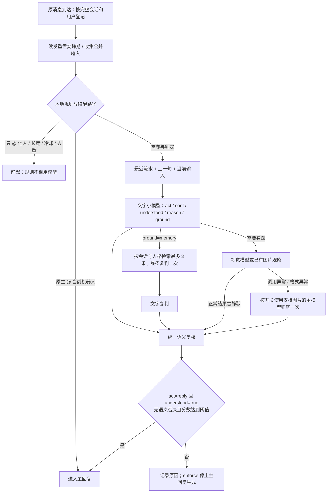
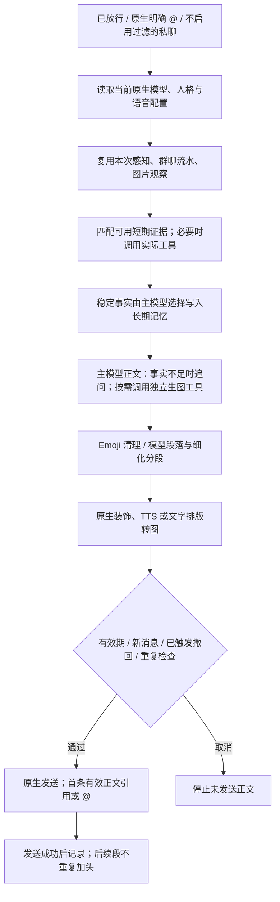
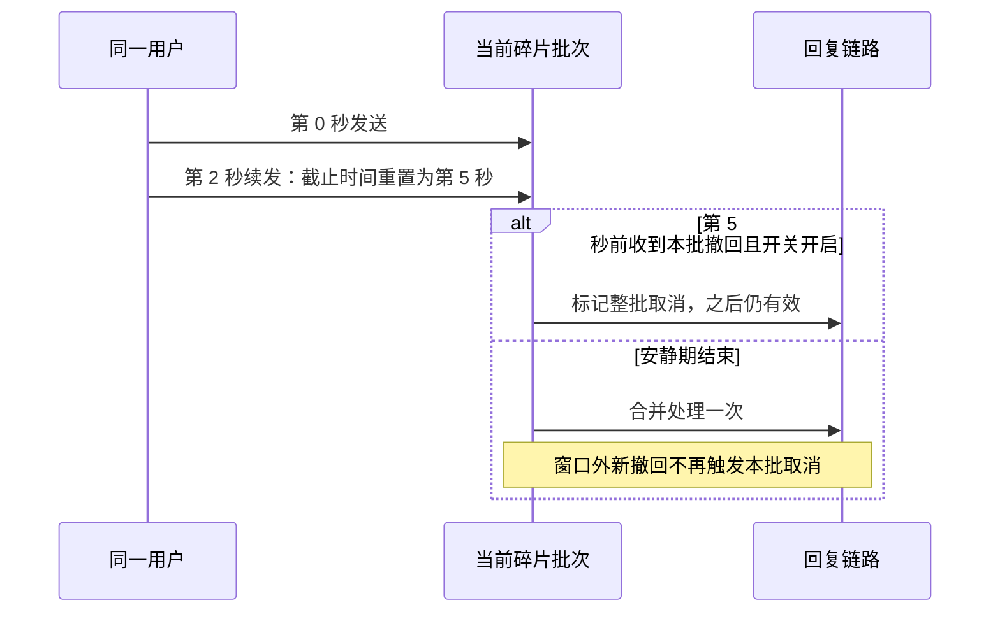

# 流程与集成说明

面向希望理解执行链路的使用者和配套开发者。当前实现依据 [main.py](../main.py)、[guard_engine.py](../guard_engine.py) 及各 `guard_*` 模块，已核对源码：2026-11-04。钩子、缓存、超时或配套约定改变时更新；以下图展示仓库实现和配套要求，不能代替部署状态验证。

## 判定流程



明确 @ 有直接放行路径，仍保留碎片等待和后续发送检查。纯文字称呼或引用唤醒在开启聚合时可对完整输入判定，后续“不用回了”可以影响结论。预算、总时限及配套可用性约束整个补查流程；正常视觉静默不会走主模型兜底。

背景不足时不靠提高分数放行。互聊、停口、已答、无贡献等语义否决独立于阈值；纠正后的分数和原始输出均保留。`act=silent` 即使原分数很高也不能放行；阈值为 0 也不越过语义约束。

`enforce` 在静默时停止主回复；`shadow` 只记录判定，继续生成；`legacy` 仍生成后清空正文；`off` 不参与判定。遇到模型失败、解析失败、背景记忆缺失或身份不明，判定默认静默。

## 生成与发送



判定放行只说明适合参与，不代表事实完整。主模型读取同会话临时背景，优先复用已有资料；实际可用的联网、记忆、向量或图片工具才能补充事实，不增加一轮固定“理解模型”调用。长期写入依赖真实工具成功，流程页计划不能证明执行过。

`guard_segments.py` 在结果修饰时准备文本段，原生流水线负责装饰、媒体与发送。结果身份和语义头由 `guard_reply_delivery.py` 传递，原生创建新 Plain、TTS 或转图片时不冻结旧全文。流式相邻 token 先缓冲为完整结果再交付，避免每个 token 单独断句。

每条发送进入事件局部锁，只模拟一次打字耗时。成功后才消费首条回复头并记账；部分失败、重复组件或流式结束不自动补发全文。图片、语音、表情包由宿主及相应插件负责。

## 独立AI生图工具

`guard_image_settings.py` 管理文生图和图生图能力，`guard_image_tool.py` 包装原生 `FunctionTool`。开启后在主模型请求阶段复制当前工具集并添加 `livinghello_generate_image`，不会修改共享人格工具集；关闭后不添加，已经拿到工具的在途请求也会在实际调用时检查开关。

工具从当前事件确定会话和参考图片，模型只能提供画面描述及是否使用本次图片，不能提交任意图片地址或本地路径。连接读取已注册原生提供者或多 API 路由的具体上游 client，模型名称可独立覆盖；不依赖 BiliBot。标准协议请求 `images/generations` 或 multipart `images/edits`；对话协议使用 `chat/completions` 的 image 模态。均只请求1张，响应图片需为PNG、JPEG或WebP且不超过10MiB。

生图前 SQLite 事务预占全插件每日额度并保存请求散列；重载后计数继续，同事件同请求不重发。上游调用失败、超时或结果未知仍占额度。返回图片后检查当前回复的撤回、上下文和时效，再通过当前事件原生发送；取消时不发送。投递未知不自动重试，已生成图片按7天期限清理。

上下文有效期0仅关闭背景时间筛选，不关闭发送有效期，也不会恢复已经从内存流水队列淘汰的内容。

## 碎片与撤回窗口

请求关联由 `guard_request_trace.py` 管理：入口将完整会话ID与UUID32请求ID绑定到事件extra，碎片合并使用取得回复权事件的规范ID，并保存来源ID关联。判定日志继续使用原文件，读取时批量关联独立SQLite追踪快照，不新增判定或预算消耗。

接收、输入解析、碎片、撤回、理解、判定、要求挂载、Agent开始、模型响应、工具开始/结束、Agent完成、结果装饰和发送完成共14项监听，核对真实激活注册表及当前实例；历史请求保存开始时的覆盖快照。生图内部预检、额度、实际HTTP请求、下载和投递另外记录步骤，与宿主工具span关联并避免重复计数。原生TTS/文本转图来源没有足够证据时标为未采集，流程试跑的生成节点仍是计划。

自己的发送照常更新群上下文版本，只有当前请求的判定版本等于发送前版本时才同步该请求快照；已有外部变化时不更新，其他请求快照也不更新。Agent完成与前置文字成功均不能代替最终投递证据。

`guard_fragments.py` 以 `(unified_msg_origin, sender_id)` 分批，用单调时钟测量安静期。同用户续发重置倒计时，只有最后触发认领整批；其他用户消息可作背景，不加入这一批。原文仍逐条由配套归档，较早分片的图片也可传给主回复。

最多 256 个活动批次，每批最多 128 条、总文本 65536 字符。超限整批静默，不截断后判断。缺少用户或完整会话标识时不聚合；重载取消等待，不持久化或自动重放。同平台会话重复消息 ID 不重置安静期，机器人自身消息和通知不入批。



等待为 0 或私聊未启用等待时没有撤回保护窗口。有效撤回取消整批未发正文；已发内容不自动删除。新群消息造成的自主回复上下文版本变化是另一项检查，仍可在正文生成和发送前取消旧回复。

## 图片与查询证据

| 资料 | 缓存范围与上限 | 使用和失败边界 |
| --- | --- | --- |
| 判定图片观察 | 完整会话与视觉模型；默认 300 秒，可关闭，最多 1800 秒 | 不缓存是否回复；命中不续期，重载清空；摘要不足仍需原图 |
| 成功查询文字证据 | 同会话、用户、人格、provider；内存最多 256 条，5 分钟 | 查询词明确命中问题，最多复用 2 条 × 2000 字符；相关工具须仍可用 |
| 长期记忆 | 实际记忆插件的统一身份、受众和隐私规则 | 仅稳定事实、来源和日期；失败结果、推测、网页指令和判定理由不能作事实 |

`guard_evidence.py` 收集 `on_llm_tool_respond` 的成功查询；不复用写入/发送工具、错误结果或完整回答，不强制拦截原生搜索。身份、人格、话题或 provider 改变以及过期均不复用。长期事实由主模型调用现有 `memorize_long_term_memory` 等工具，时效内容过期后重查。

LivingMemory 长期工具原默认关闭，须启用 `agent_tools.enable_memorize_tool` 并重载，确认工具列表存在后才能写入。不能仅凭提示词宣称已写入，也不建立绕过权限的另一份长期向量库。

配套从绫可共用本事件的感知解析和图片观察，避免归档、作息和生成分别理解。其当前图片观察可按会话/用户/人格缓存、最多 1200 字符；能力缓存遵守各自 TTL、隔离和并发合并约定。具体从绫缓存实现须核对配套版本，不能将这些要求视为 LivingHello 自动修改了另一插件。

## 从绫配套

当前事件是否启用从绫由其已激活实例 `enabled_for(event)` 决定。LivingHello 管理参与判定和发送格式，从绫感知、情绪、关系、记忆、作息仍按自身配置运行。不要用独立理解结果跳过其原生感知。

AstrBot 请求钩子按优先级从高到低执行：

```text
逐条记录原文与未读历史
  → LivingHello guard_llm_request（10000）
  → enforce 静默：停止请求，不爬楼，不消费这批未读
  → 放行：从绫人格准备（配套实现须低于 10000，如 9000）
      → 按自身开关爬楼 / 读取历史 / 补答
      → 本次请求注入背景和人格
  → 主回复生成
  → LivingHello 在模型返回与发送前复查
```

相同优先级不保证上述顺序。需同步配套版本，只有 LivingHello 更新不会自动补齐从绫钩子、准备计时或固定人格兼容。

从绫在本事件用 `set_extra("congling:wake_prepare_seconds", seconds)` 上报实际爬楼/补课准备秒数，宜用 `time.monotonic()` 在准备阶段 `finally` 中记录，不能包含正文生成。`gate_congling_prepare_compat` 开启时：

```text
有效已用时间 = 收消息后的总时间 - 当前事件有效准备时间
有效已用时间超过 gate_reply_max_age_seconds → 取消自主回复
```

计时须为 0 到实际事件年龄之间的有限数，布尔、负数、NaN、无穷、不可解析或超过总年龄均不扣除。无从绫、旧版未上报或缓存摘要无本次准备耗时，不凭空延长期限。计时不跨事件复用。

默认机会有效期 30 秒时：

| 总年龄 | 当前准备 | 有效年龄 | 没有新消息时 |
| --- | --- | --- | --- |
| 60 秒 | 45 秒 | 15 秒 | 可继续当前回复 |
| 80 秒 | 45 秒 | 35 秒 | 取消过期回复 |
| 60 秒 | 未上报或适配关闭 | 60 秒 | 按原规则取消 |

新群消息改变上下文版本时仍取消旧自主回复；显式呼叫沿用直接呼叫规则。原生固定人格通过 `get_fixed_native_persona_id(umo)` 供兼容从绫优先读取，避免旧会话选择覆盖。

从绫独立设置：`night.crawl_enabled` 控制爬楼，`night.rollup.enabled` 控制醒后补课，`compat.at_guard_coupled` 控制补课评分耦合；这些均不控制钩子顺序或计时上报。冻结历史上界、读取成功后标记已读、发送结果未知时防重复，由从绫维护。

关闭 `gate_congling_prepare_compat` 可恢复原年龄算法，不改数据库和已读状态。不要为绕过失败而自动重发；排查 `context_changed`、`message_expired`、`_at_guard_delivery_blocked` 及从绫异常。

## 原生模型与固定人格

`guard_native_settings.py` 按目标原生配置保存主模型、默认TTS模型、语音回复开关及排版等公开字段。聊天与TTS Provider按角色隔离；语音字段与模型字段共用revision、磁盘一致性检查、原子补丁和流水线刷新。AstrBot原生页面修改后重新读取即可同步，本页保存也直接写回同一原生配置。固定人格文件 `native_persona_pins.json` 保留在旧技术 ID 的数据目录。

插件生命周期包装 `PersonaManager.resolve_selected_persona`，先确定所属原生配置，再返回固定人格原生对象，使系统提示、开场、工具和技能一致；未固定时沿用宿主选择器。固定人格已删除或文件损坏时明确失败，不自动换人。重载清理自己的包装，避免叠加。

## 公开配套打分

`await plugin.at_guard_score(text)` 不需要事件，只使用钉死的判定模型；留空、模型缺失、输入空、模式 `off` 或判定异常返回 `None`。正常返回 `{"score": 分数}`；语义静默返回 0，避免旧调用方只看分数而忽略否决。

此入口不读取真实会话背景，使用 dry-run 不污染业务分布和预算，但真实模型 API 仍计费。调用方应自行定义 `None` 的降级行为，不能把它解释为“肯定可回复”。
