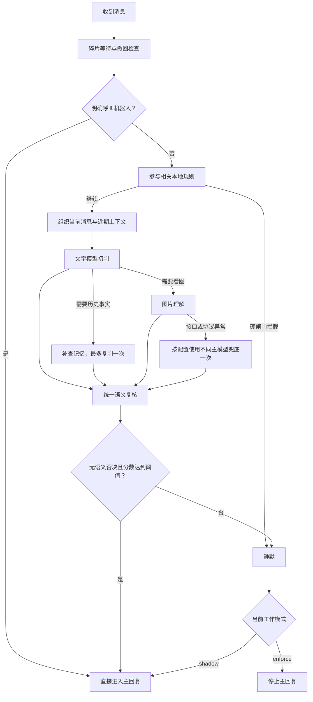

# LivingHello 判断逻辑说明

本文单独说明 LivingHello 如何判断“机器人现在该不该接话”。它描述的是仓库当前实现，不代表模型永远判断正确，也不能把参与分数当作事实置信度。

## 先看结论

LivingHello 把一条消息分成三类：

| 输入类型 | 处理方式 |
| --- | --- |
| 原生 @ 当前机器人、唤醒词或明确称呼 | 直接进入主回复，不调用参与判断小模型 |
| 普通群消息 | 完成本地规则、文字判断、按需补证、语义否决和阈值比较 |
| 私聊消息 | 默认直接交给主模型；开启私聊参与过滤后才走判断 |

最终动作只有两个：

- `reply`：允许进入主回复生成。
- `silence`：本轮不适合参与。

工作模式决定这个结论是否真正拦截：

| 模式 | 判断结论的作用 |
| --- | --- |
| `enforce` 硬闸门 | `silence` 停止主回复生成；`reply` 才继续 |
| `shadow` 观察模式 | 完整判断并记录，但本地参与规则和模型结论都不拦截主回复 |

观察模式不是关闭判断。它仍会等待判断完成，并产生相应 API 用量。

## 判定 API 断线恢复

“回复与私聊 → 断线恢复”默认关闭。开启后，LivingHello 会为文字判定 API 的临时外部异常建立恢复事件。

可自动恢复的异常包括：

- 判定调用超时；
- 连接拒绝、连接重置、DNS 或 TLS 临时失败；
- 429、5xx 或上游短暂不可用；
- 空响应或无法解析的判定协议。

401/403、密钥失效、Provider 被删除或配置缺失需要管理员处理，不会伪装成一次可自动恢复的网络抖动。判定预算用完、模型正常静默和语义否决不属于断线。

恢复流程：

1. 记录脱敏错误并私聊 AstrBot 全局管理员；
2. 进入固定 10 分钟冷却，普通判定不再重复调用异常 API；
3. 硬闸门记录受影响会话并静默；观察模式继续回复，不加入补答；
4. 冷却结束后用不含用户数据的探测请求检查当前判定 Provider；
5. 探测成功后，配套插件按故障时间窗口补看受影响会话；
6. 只有仍需回答且尚未被回答的内容才会补答。

补答先道歉，再按当前人设使用“刚才没跟上”“一时没注意到”等非技术解释，然后回答遗漏内容。普通用户不会看到服务器、API、模型、网络、系统、插件、数据库、故障或超时等技术原因；真实错误只发给管理员。

明确 @、唤醒词和不依赖文字判定的直通路径在冷却期间仍可用。配套插件未安装或不可用时，LivingHello 可以恢复正常判断并通知管理员，但不能承诺自动补看历史。

这个能力覆盖的是文字判定依赖，不是整个机器人系统的通用容灾。主回复模型、视觉/TTS、生图、消息平台、最终发送、进程崩溃、数据库损坏和代码异常仍使用各自的失败边界。

## 总流程



碎片等待、撤回、私聊范围、主模型自身选择静默和平台发送失败是独立边界。观察模式不会绕过这些机制。

## 第一步：明确呼叫与本地规则

### 明确呼叫

原生 @ 当前机器人属于强意图，直接进入主回复。这样可以避免小模型把用户明确提出的问题误判成群友互聊。

直接放行不等于忽略输入理解：

- 引用、转发、卡片和媒体仍需解析；
- LivingHello 的独立图片理解仍可读取当前图片或被引用的历史图片；
- 发送前仍检查撤回、上下文变化和回复机会是否过期。

### 参与相关本地规则

普通群消息在调用判断模型前先检查：

- 只 @ 其他用户；
- 近期重复消息；
- 主动回复冷却；
- 同群已有参与请求处理中；
- 归一化后文字过短或没有有效内容；
- 每群小时判断预算。

硬闸门中，本地规则可以直接静默并节省模型调用。观察模式中，这些规则只写入记录，主回复仍可继续。

## 第二步：组织判断上下文

判断上下文只使用本次会话范围内的资料：

- 当前发送者和当前消息；
- 已配置数量的近期消息，按从旧到新排列；
- 机器人近期上一句；
- 当前消息里的引用、图片可用性和明确呼叫信息；
- 本次请求已提供的配套插件临时感知或 LivingMemory 事实结果。

`gate_context_max_age_seconds=0` 表示不按时间过滤，但仍受流水条数和字符上限约束，不会读取无限历史。

消息正文、引用内容、图片文字和检索结果都是不可信资料，不能覆盖系统规则。

## 第三步：文字模型初判

文字模型必须返回结构化结论，核心字段如下：

| 字段 | 含义 |
| --- | --- |
| `act` | `reply` 或 `silent` |
| `conf` | 0–100 的参与适合度 |
| `understood` | 是否理解当前话题、对象和指代 |
| `reason` | 为什么适合参与或为什么应静默 |
| `ground` | 是否还需要记忆或外部事实 |
| `need_vision` | 当前图片是否决定理解和参与 |

分数的大致含义：

| 分数 | 解释 |
| --- | --- |
| 0–20 | 群友互聊、话题结束、不应打扰或没有贡献 |
| 21–40 | 背景、对象或指代仍不清楚 |
| 41–60 | 已理解，但参与价值有限或邀请不明确 |
| 61–75 | 能自然提供具体帮助 |
| 76–90 | 明确承接机器人近期发言且需要继续回应 |
| 91–100 | 明确邀请机器人参与且背景充分 |

`conf` 不是事实正确率，也不是单独的放行票。高分仍可能被语义否决。

## 第四步：按需补证

### 记忆

只有初判明确需要历史事实时才补查记忆：

1. 按当前会话、身份和受众边界检索；
2. 最多取少量相关事实；
3. 命中后复判一次；
4. 没找到时不能猜测。

与配套插件和 LivingMemory 配套时，LivingHello 复用本次请求已装配的关系、感知和事实结果，避免同一请求重复查询。

### 图片

图片有两种用途：

- **参与判断图片**：只有图片内容决定“该不该接话”时才调用视觉判断。
- **输入理解图片**：即使原生 @ 直接放行，也要让主回复知道当前或被引用图片的可见内容。

LivingHello 使用自己的 `understand_image_provider_id` 执行输入图片理解。与配套插件联用时：

- 配套插件继续处理引用作者、文字、转发、卡片、语音、记忆和人格；
- LivingHello 声明本轮图片所有权；
- 配套插件跳过自己的图片理解，避免同图重复调用；
- LivingHello 生成带来源说明的临时摘要，再交给主回复；
- 原图不会被强制交给主回复模型，因此文字模型也可以使用。

用户引用历史图片时，摘要会标记为“用户引用了某人的历史图片消息”。如果图片模型超时、失败或返回空结果，主回复收到的是“本轮未能识别，请勿猜测画面或来源”。

### 视觉异常兜底

只有视觉接口调用失败、超时或协议无效时，才按开关尝试不同的会话主模型做一次参与判断兜底。

以下情况不会触发兜底：

- 视觉模型正常返回 `silent`；
- 预算用完；
- 总判定时限已到；
- 兜底模型与失败模型相同；
- 主模型不支持图片。

## 第五步：语义否决

语义否决优先于分数和阈值。常见原因：

| 原因 | 行为 |
| --- | --- |
| `others_talking` | 群友之间正在对话，机器人不抢话 |
| `conversation_ended` | 用户明确结束当前话题 |
| `already_answered` | 问题已经被回答，不重复附和 |
| `context_missing` | 背景、对象或指代不清 |
| `media_unresolved` | 必要图片或媒体未理解 |
| `no_value` | 即使理解也没有具体贡献 |

发生否决时，修正分数会被压低。即使阈值设为 `0`，也不能绕过语义否决。

## 第六步：阈值比较

只有同时满足以下条件才得到 `reply`：

1. 模型动作是 `reply`；
2. `understood=true`；
3. 没有语义否决；
4. 修正后的参与分数达到本次保存的阈值。

因此：

```text
分数达标 ≠ 一定放行
```

最近判定中的“参与适合度”显示为：

```text
当前分值 / 本次判定阈值
```

绿色只表示分值达到阈值，不代表其它条件也通过。

## 第七步：生成和发送

判定放行或观察模式继续后：

1. 使用当前会话的原生模型、固定人格和回退设置；
2. 复用本次图片摘要、记忆和工具证据；
3. 主模型生成正文，也可以自行选择不回复；
4. 按原生分段设置处理正文；
5. 最后检查新消息、撤回、重复和回复机会时效；
6. 通过 AstrBot 原生发送链路投递。

独立 AI 生图属于主模型可选工具，不是参与判断。生图工具是否调用，以实际工具记录为准。

## 典型例子

### 群友互聊

```text
甲：这个副本怎么走？
乙：从左边楼梯下去。
甲：好，我看到了。
```

机器人即使知道答案，也应识别为已回答或群友互聊，保持静默。

### 明确 @

```text
用户：@机器人 这张图里的报错是什么意思？
```

参与判断直接放行，但图片理解、人格、工具和发送前检查仍执行。

### 引用历史图片

```text
用户引用机器人之前发送的图片：这些图是什么内容？
```

LivingHello 从 Reply 或历史消息接口取回图片，调用自己的图片理解模型，并向主回复提供带引用来源的摘要。配套插件不会重复看图。

### 高分但背景不明

```text
用户：那它后来怎么样了？
```

若近期流水无法确定“它”指什么，应为 `context_missing`。不能只因问题语气明确而高分放行。

### 结束后提出新问题

```text
用户：上个话题先到这里。对了，新版本怎么加点？
```

结束旧话题不等于永久禁言。新的明确问题应重新评估。

## 如何核对一次实际判断

在 **插件详情 → guard → 运行概览** 查看最近判定：

1. 用对话 ID、`request_id` 或原话搜索；
2. 先看“文字判断结果”和“判断结果”；
3. 对比分值与本次阈值；
4. 打开详情，按 1–5 查看接收、判断、生成、工具和发送；
5. 再展开上下文、模型尝试、耗时和监听状态。

文字试跑只执行参与判断，不读取真实用户记忆、不上传图片、不生成正文，也不发送消息，但会调用已配置的判断模型。

更完整的钩子顺序、缓存、撤回和配套约定见[流程与集成说明](architecture.md)。操作步骤和故障排查见[使用指南](usage.md)。
