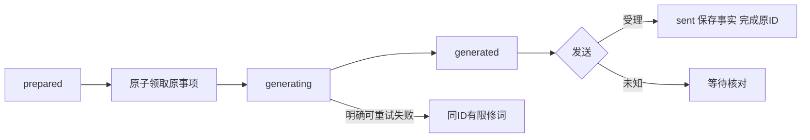

# 图片回执与原事项结算

来源：[图片服务](../images/guard_image_settings.py)、[图片投递](../images/guard_image_delivery.py)、
[LE桥](../integrations/guard_livingemotion.py)与离线门面测试。

## 生成与发送事实

工具先预检；`prepared` 不请求生图接口。QQ 私聊即时单图在准备后并行启动文字和生图，其他路径沿用原先的发送顺序。同一图片沿用会话、消息、描述与参考图开关计算的 `request_id`。

普通、后台和定时发送共用同一账本。QQ 只认该图片发送动作返回的非零 `message_id`；AstrBot 的 `Context.send_message=True` 只说明找到平台。其他适配器需要明确返回发送成功才确认。`sent` 表示平台受理，用户是否已读未知；无回执或发送结果未知时不自动重发，同一 `request_id` 的成功回执只结算一次。

`image_quota_slots` 分开记录临时留位与 `sent_day`，按服务器本地确认发送的日期统计；留位跨午夜时仍防止并发超量。失败、取消和结果未知不计为已发送；异常退出残留的留位到期释放。旧 `calls` 行保留防重，旧回执保留历史，不回填未按新口径确认的发送。`image_receipts` 保存交付事实，晚到失败不覆盖成功。

下一轮读取同会话、用户、人格及修订的最近5条、七天内事实，临时注入模型上下文。
关闭新生图或用尽额度仍能读历史成功；没有可靠人格时不查询其他身份。
需求和上游revised_prompt注明来源，不当作视觉观察。
重启后失去本地执行归属的 `generating` / `generated` 历史显示结果未知，不自动重画或重发。仅凭历史状态对账不会释放可能仍由其他执行方持有的留位。

## 按原promise_id执行

生图工具带promise_id时，通过livingemotion.image-result.v1在收费前原子领取。
LE核对图片事项、原真实来源、运行代际与状态，并禁止定时扫描重复执行。
发送结果只结算同promise_id和request_id；未带ID的新图不清除其他旧事项。
成功退出待办并保存交付事实；未知结果保留原事项等待核对。

明确限流或授权提示词拒绝移回同ID队列，清除外部归属；按映射策略有限等义调整。
followup_id只用于用户明确调整需求后恢复原事项，不能借它重试未知请求。
同轮只执行第一张图，第二个不同请求明确返回未执行。
对端暂时不可用时保存回执，后续对账只重放结果，不重新收费、不重新发送。

## 离线验证

tests/test_image_receipts.py覆盖持久事实、各种投递、重启、重复、身份隔离和同轮第二张。
tests/image_result_handoff.py为显式双插件层，使用真实工具及LE门面、
假Provider与假发送。运行方式见[开发维护](development.md)。
