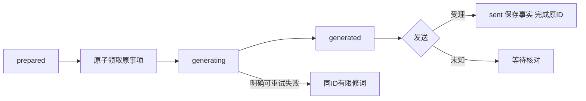

# 图片回执与原事项结算

适用LH2.9.6 / LE0.7.1，2026-11-23核对。来源：
[图片服务](../images/guard_image_settings.py)、[LE桥](../integrations/guard_livingemotion.py)与真实门面测试。

## 生成与发送事实

工具先预检；prepared不请求上游、不代表送达。主回复发送后启动生成，
沿用会话、消息、描述与参考图开关计算的request_id。
image_generation_quota.sqlite3新增image_receipts表，记录generating、generated、sent、
明确失败、取消和未知结果。旧额度计算不改变，sent永不被晚到失败降级。

同步、后台、延迟图共用交付事实。原生event.send正常返回None按宿主受理处理，
显式False、异常或计划失败不能算成功；context.send_message必须明确True。
sent只表示发送调用受理，不表示用户已读。

下一轮读取同会话、用户、人格及修订的最近5条、七天内事实，临时注入模型上下文。
关闭新生图或用尽额度仍能读历史成功；没有可靠人格时不查询其他身份。
需求和上游revised_prompt注明来源，不当作视觉观察。
重启后失去本地执行归属的generating/generated转为未知，不自动重画或重发。

## 按原promise_id执行

生图工具带promise_id时，通过livingemotion.image-result.v1在收费前原子领取。
LE核对图片事项、原真实来源、运行代际与状态，并禁止定时扫描重复执行。
发送结果只结算同promise_id和request_id；未带ID的新图不清除其他旧事项。
成功退出待办并保存交付事实；未知结果保留原事项等待核对。

明确限流或授权提示词拒绝移回同ID队列，清除外部归属；按映射策略有限等义调整。
followup_id只用于用户明确调整需求后恢复原事项，不能借它重试未知请求。
同轮只执行第一张图，第二个不同请求明确返回未执行。
对端暂时不可用时保存回执，后续对账只重放结果，不重新收费、不重新发送。

## 离线验证

tests/test_image_receipts.py覆盖持久事实、各种投递、重启、重复、身份隔离和同轮第二张。
tests/image_result_handoff.py为显式双插件层，使用真实工具及LE门面、
假Provider与假发送。运行方式见[开发维护](development.md)。
