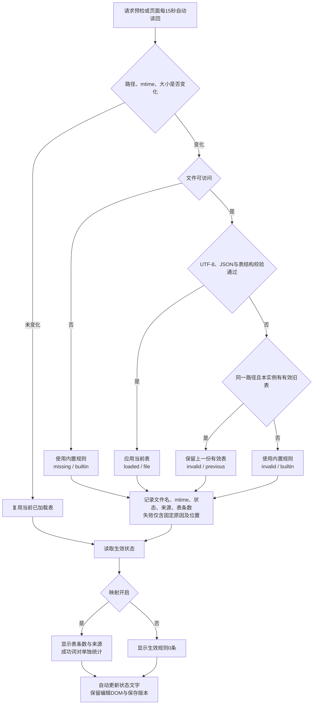
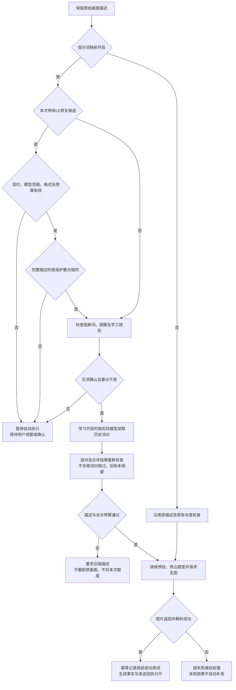

# 生图提示词映射与成功用词

适用 LH 2.9.7；承诺自动调整与原事项回执配套 LE 0.7.1或更新版本。旧生图配置缺少以下四项时自动补默认值，
已选连接、尺寸、超时、风格和每日额度保留；不要求重置配置。

入口：LH 配置页 → AI生图。四项配置独立平铺：

| 配置 | 默认 | 用法 |
|---|---|---|
| 启用提示词映射 | 开启 | 请求前应用规则，关闭恢复原描述 |
| 提示词映射表路径 | `image_prompt_rules.json` | 相对路径从 LH 插件数据目录解析；支持绝对路径 |
| 提示词自动调整次数 | 2 | 0–10 次；需要 LE 开启承诺兑现并启用耦合，取两端较小值 |
| 记录并复用成功用词 | 开启 | 同一实际连接、模型、协议复用成功请求中的局部替换 |

原始描述保留。英文替换按词边界匹配，不把 `necklineish` 当作 `neckline`。
自动替换只用于等义措辞；姿势、表情、年龄、衣着覆盖度、场景变化需要用户确认。
内置规则只有 `neckline → collar`，不默认修改腰部、肚脐、姿勢，也不默认增加脚部或身体要求。
自定义映射表、生图风格和成功学习数据库保留在本地插件数据目录，不随源码发布。
内置规则不代表线上验证成功；成功等义替换按实际连接、模型及协议保存在 `image_prompt_mappings.sqlite3`。

自动调整次数支持0–10，默认仍为2；在「AI生图」设置，实际取该值与LE剩余自动调整次数的较小值。LE 0.7.1在「承诺代办」设0–10，默认5；任一端设0关闭自动改词。普通任务先按原描述有限重试：网络类或带明确错误码/类型的错误体最多追加两次，内容拒绝最多追加两次，混合失败总请求最多五次。LE承诺任务遇到超时、5xx或网络断开等未知结果立即停止内部重发；无信息的未知结果也不自动重发。耗尽或取消保留原请求证据。本地任务预占一次额度，上游计费规则由实际连接决定。

## 外部表与热更新

将下面的 JSON 保存到 LH 插件数据目录，与 `image_generation.json` 同级。
修改表后下一次请求或页面自动读回时读取，不需要重启。缺失回退内置规则；文件损坏使用上一份有效规则，
配置页显示原因。文件最大 256 KiB，最多 200 条规则。
页面自动读回生效规则数、当前来源（当前映射表／上一份有效表／内置规则）和具体校验失败原因；
规则数只计算映射表规则，当前模型的成功词对单独统计。关闭映射时生效规则数为0。
每次文件状态变化记录一条加载日志：文件名、mtime、状态、来源、规则数；失败使用WARN，
格式错误只记录JSON位置或规则序号及固定原因，不记录提示词、规则正文、完整路径或凭据。
同一份文件反复读取不重复打印；写坏后修复文件即可热恢复。
上一份有效表只保留在当前实例内，并要求同一路径；换路径或插件重载后的首次无效表回退内置规则。
页面每15秒自动读取状态。日志的 `rules` 是实际加载表条数；页面的 `rule_count` 是开启时可用条数，
关闭映射显示0。规则数不表示每个请求都命中或可以免确认执行，成功词对独立统计。

```json
{
  "version": 1,
  "limits": {"desc_soft": 400, "desc_hard": 500, "total_hard": 900},
  "blocklist": [],
  "rules": [
    {"id": "collar", "type": "token", "from": "neckline", "to": "collar"},
    {
      "id": "brief-expression",
      "type": "regex",
      "pattern": "slight smile[^,.;\\n]*",
      "to": "slight smile"
    },
    {
      "id": "body",
      "type": "inject_if_missing",
      "pattern": "完整身体",
      "to": "完整身体，四肢自然"
    },
    {
      "id": "pose-review",
      "type": "advisory",
      "pattern": "对称站姿",
      "notice": "可以试试非对称站姿，但这会改变姿势，需要你确认。"
    }
  ]
}
```

此例中的补充和提醒均为可选规则，按自己的模型和画面需求选用。
`token` 替换局部词语；`regex` 使用简单正则，不支持分组、反向引用和多个无限重复；
`inject_if_missing` 未匹配时补充，已经包含补充句则不重复添加；
`advisory` 匹配后保留原描述并询问，不发送改变后的姿势。
LH 2.9.7 的 `token.from` 也可写成数组，例如 `["blouse", "shirt top"]`；
最多20个来源词，每个1～100字，不允许空值、非字符串或忽略大小写后的重复值。
同条规则长词优先，所有 token 替换同时应用，不把替换产物再喂给下一条 token 规则。
各类规则可加 `when` 简单正则，只有描述命中该条件才应用，例如
`{"id":"garden-shirt","type":"token","from":["blouse","top"],"to":"shirt","when":"garden"}`。
数组和组合条件仍需通过画面要点检查；改变姿势或衣着覆盖度仍需确认。
替换规则也可设置 `requires_confirmation: true` 和 `notice`。
`blocklist` 命中后暂停并要求调整，不能静默删词。
正则中的 `[^,.;\n]` 避免吞掉下一条英文画面子句；有中文标点时可加 `，。；`。

长度单位为 Python 字符数，不是 token。默认描述尽量 400 字，硬上限 500 字，
描述、时间、全局风格总长 900 字。超长描述在扣额度前要求压缩；
只有全局风格可为总长限制而截短，原始画面描述不截断。关闭映射后沿用原有 4000 字上限。
开启时间注入时，其实际字符数会从总长中扣除，LE 获得的描述压缩预算同步减少。

## LE 承诺重试

LH 明确内容拒绝或描述超长时，如果 LE 能接手，会交接同一图片义务。
LE 使用自己的 `closing` 收尾模型提出 JSON 局部替换；没有单独新增模型配置。
到期图片承诺也走同一套逻辑。

```json
{"changes_scene": false, "substitutions": [{"from": "blouse", "to": "shirt"}]}
```

超长描述可以改为 `shortened_prompt`，不将全文压缩当作可复用词语规则。
模型需要改变场景时应返回 `changes_scene: true` 和简短 `notice`；随后询问用户。
本地再检查候选格式、源词存在、空替换、年龄/姿势/表情等明显变化和实际模型范围。
语义等价仍依赖收尾模型判断，检查不能证明所有替换完全等价。
手工规则、LE修复候选（含全文压缩）和历史成功词对统一比较完整描述中的受保护要点。
例如 `lying on her back → lying face up` 保持同一朝向，可通过；`kneeling → reclining`
改变姿势，需要确认。`nude` 只在 `nude color` 等明确颜色语境中豁免，裸露描述仍保留校验。
历史成功词对重新校验，不通过的词对停止复用但不删除旧账本；显式确认规则仍需用户确认。

## 加载与校验逻辑

第一张图说明文件怎样被加载和展示。文件状态没有变化时直接复用当前表；
首次读取、修改、删除或改路径才重新判定并记录日志。



第二张图说明候选怎样成为实际请求。要点比较使用完整描述，且在扣额度和请求上游之前执行。
历史词对不合格时跳过；手工或LE候选需要改变要点时交给用户确认。



打开[在线交互示例](https://akihunter.github.io/astrbot_plugin_livinghello/image-mapping-flow/)，
切换六种加载状态和六种修复案例。示例使用离线数据，不读取线上配置或调用模型。
也可下载仓库后打开[HTML文件](image-mapping-flow/index.html)离线操作。

每次明确尝试使用独立 ID，尝试次数和候选在生图前落 SQLite。
崩溃后只有已准备且尚未发起请求的候选可恢复；`generating`、`sending`、`unknown`
不会自动补发。生图期间占用临时留位，图片发送获确认后才计入每日额度。失败、重复回执和超时不算成功用词。
自动调整耗尽、无合适等义词或需要改变画面后，保留同一任务等待用户调整或取消。
用户新一轮明确调整会清除旧候选，并为新画面重置配置的调整预算；纯“再试一次”不重置预算。
图生图失败不自动转成纯文字生图。

## 成功记录与追踪

`image_prompt_mappings.sqlite3` 保存短词对、成功/拒绝次数、更新时间及请求/原文哈希。
不存 API Key、服务地址明文或整段用户提示词。模型范围包含连接 ID、实际服务地址哈希、
实际模型和协议；换模型或服务地址不会混用记录。
只有图片返回并完成解析才记录成功，不依赖聊天模型声称“画好了”。
同一请求重复记录不累加；已复用词语再次被明确拒绝时降权，
成功数不超过拒绝数的词对停止自动复用。最多保留 1000 个词对，观察回执保留 30 天。

这些记录表示“成功请求中用过”，不能证明该词导致成功，也不保证以后通过内容检查。
图片质量、身体完整度和用户满意度没有自动视觉验收；可选质量复核未纳入此版。
请求 trace 的 `prompt_guard` 记录规则 ID、模型、改前改后长度，不记录提示词正文。
`before / after` 仍指描述段；`desc_len` 是映射后的描述长，`style_len` 是实际追加的风格正文长，
`time_len` 包含时间提示及其换行，`total_len` 是最终发往上游的总长。
追加风格时其前置换行另占1字；风格被截断时记录截断后的长度，不能将配置原长当作实际请求长。

## 离线验证

LH：`python scripts/run_boundary_tests.py --test test_image_prompt_mapping`。
LE：按现有包名环境执行 `pytest tests/integration/test_image_prompt_mapping.py`。
测试覆盖热更新、词边界、注入去重、确认提醒、模型隔离、成功学习、拒绝降权、
重试上限、取消、未知结果保护、准备候选恢复及用户调整恢复；全部使用夹具，不产生付费请求。
